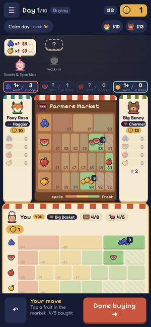
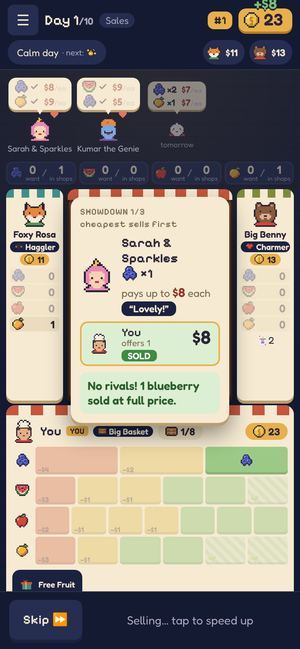
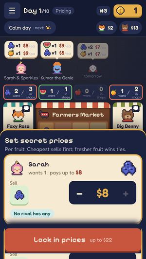
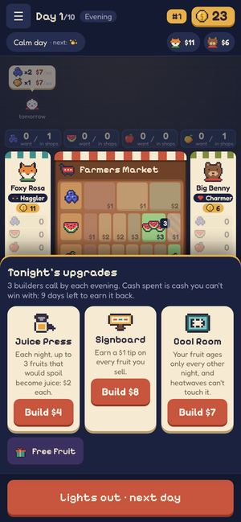
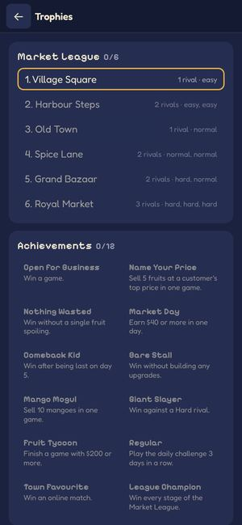

# REP-014 · UI and UX polish: what feels unfinished, and a plan for the whole game

| | |
|---|---|
| Game | Fruit Market |
| Report date | 2026-10-26 23:06 (Asia/Kuala_Lumpur) |
| Owner input | "the look and feel of the game doesnt feel polished" and "the whole UI … propose changes on the whole UI UX" |
| Build reviewed | 1.1.1 candidate (`main` @ `83de99b`), phone sizes 360×640 and 390×844 |
| Type | Review and proposal. **No game changes were made.** |
| Approval status | DEC-020, PLAN-007 and PLAN-008 **awaiting approval** |

## 1 · What I looked at
Every main screen at two common phone sizes: home, trait pick, buying, pricing, sales reveal,
evening upgrades, results, trophies, online lobby and new game. The same checks the browser tests use:
whether anything is cut off, overlaps or wastes space.

 
 

## 2 · Why it doesn't feel polished: four causes

**A. Things that look broken (defects, easy to fix)**
1. **Sales reveal:** on shorter phones the explanation is cut off at the bottom ("…sold at full price"
   disappears behind the bar), and the card covers your own stall.
2. **The "+$8" money pop** flies off the top of the screen.
3. **Grammar:** "**You offers** 1" on the reveal card.
4. **Pricing panel:** the "Lock in prices" button floats over the next customer's card, which shows underneath it.
5. **Evening upgrades:** the Build buttons sit at different heights; card text is long and uneven.
6. **Trait picker:** the title wraps awkwardly and the panel covers your stall.
7. **Mixed icon styles:** emoji (🃏 favour count, ⏩ Skip, 💭, 📊, 🔒, 🙋/🤖) beside the pixel art.
8. **Placeholders that look unfinished:** the grey "walk-in" and "tomorrow" ghosts and the dashed "?" bubble.
9. **Trophies:** achievements have no icons, and locked and unlocked look the same (all grey text).

**B. Too much on screen at once (layout)**
- Before the table you see: the top bar, a second row (event, rival cash), customers, and a 4-box
  demand strip ("1+ want / 3 in shops"). That's four bands of small information.
- **Numbers shown twice:** your cash (top right and your stall) and rivals' cash (top chips and their stalls).
- **Rival stalls** take about 40% of the width to show mostly "0" rows, which squeezes the farmers market
  and makes its price labels ($1 $2 $3) tiny.
- **Your stall** is a big grid of empty pastel boxes with tiny "−$2" labels. Hard to read at a glance.

**C. No single focus per moment**
Every phase shows the whole table at the same size. When you're pricing, the customers matter most;
when you're buying, the market does. Right now nothing steps forward, so your eye has nowhere to land.

**D. The visual system isn't consistent**
- Two fonts are used without a clear rule: the pixel font appears in titles, numbers and small labels alike.
- Cards come in several styles: cream paper, navy chips, outlined boxes.
- Colours carry meaning (red outline, green outline, teal), but it isn't explained or applied consistently.
- Feedback and motion are uneven: some actions animate, others just switch.

## 3 · Proposal: three phases, smallest risk first

### Phase 1 · Fix what looks broken (PLAN-007, build now, low risk)
All nine items in **A**, presentation only:
- the reveal card fits every phone and stops covering your stall
- the money pop stays on screen
- the grammar and other copy are corrected
- the pricing button sits in a solid footer
- upgrade cards are aligned and their text shortened
- the trait picker fits
- the remaining emoji become pixel icons (backlog B-33)
- the walk-in and tomorrow placeholders get proper art
- trophies get icons and a clear locked look

Ships with the Patches rename as **1.1.2**.

### Phase 2 · Calm the table (PLAN-008 mockups first, then a build plan)
- **One compact top bar:** menu · day · phase · today's event icon · your cash and rank. Rivals' cash appears only on their stalls.
- **Slim rival stalls:** face, name, cash, and only the fruit they actually hold. This frees width so
  the farmers market and its prices get bigger.
- **Plain-language demand:** replace "1+ want / 3 in shops" with icons and words on the customer bubbles,
  for example "2 shops selling: price war".
- **Your stall:** show your fruit as items with "nights left", not a grid of empty boxes.
- **One focus per phase:** buying enlarges the market; pricing brings customers forward and dims the
  rest; the reveal gets the full stage; the evening shows only the upgrades.

### Phase 3 · Make it feel finished (after Phase 2 is approved)
- **A small design system:** one type scale (pixel font for titles and big numbers only), one
  card style, spacing on a fixed grid, and colour roles (green good, red risk, gold money, teal info).
- **Motion and feedback:** phase transitions, a press effect on every button, and the **chalkboard
  reveal** from REP-010 (price boards flip). The reveal waits for the playtest result, because it's pillar 2.
- **Sound paired with the key moments** (backlog B-34), plus the harbour-market identity (DEC-017) on the
  home screen: a harbour backdrop, crates, chalkboards.

## 4 · Order of work (recommended)
1. **Now:** publish 1.1.1 and run the first playtest (DEC-016) on the *current* look. That gives a baseline,
   so we can show whether the new UI really makes the game clearer.
2. **Now, in parallel:** build Phase 1 (PLAN-007). Low risk; goes out as 1.1.2.
3. **Then:** PLAN-008, interactive mockups of the buy, price, reveal and evening screens plus home, as a
   page you can open on your phone, with two options where there's a real choice (for example, the
   rival stalls). **No game code.** You pick.
4. **Then:** a build plan for the chosen design (Phases 2 and 3), released as **1.2.0**, followed by a second playtest compared with the baseline.

## 5 · PLAN-007 acceptance (Phase 1)
- P1. Every item in **A** has before-and-after screenshots at 360×640 and 390×844.
- P2. Nothing is cut off or overlapping, and nothing scrolls sideways, on those sizes (automated check on each phase screen).
- P3. The visual-diff tool shows changes only on the screens being fixed.
- P4. The speed budget still passes (no long tasks over 200 ms; page size within budget).
- P5. `verify:full` is green; no rule, save or server changes.

**PLAN-008 acceptance (mockups):** an interactive page you can open on your phone, covering 5
screens, with clear options where a choice is needed, and every idea mapped to a problem above.
No game code.

## 6 · Costs and risks
- RM0. No new tools or services.
- **Risk:** Phase 2 changes how the table is laid out, which could confuse returning players. Mitigation: mockups first, then the second playtest.
- **Risk:** polish can expand forever. Mitigation: each phase has a fixed list and its own approval.

## 7 · Questions for you (max 3)
1. **What bothers you most?**
   - (a) cluttered screens
   - (b) things that look broken
   - (c) it lacks animation or "feel"
   - (d) the art style itself

   (This sets the Phase 2–3 priorities. If it's (d), that's a bigger art decision.)
2. **Is there a game whose look you'd call "polished"?** A name or a screenshot helps me aim the mockups.
3. **Approve PLAN-007 (Phase 1 fixes) and PLAN-008 (mockups)?**

## 8 · Decisions

| ID | Question | Recommendation | Status |
|---|---|---|---|
| DEC-020 | How to polish the UI and UX | Three phases; fix defects first; mockups before any layout change; a playtest before and after | Awaiting approval |
| PLAN-007 | Phase 1: fix what looks broken | Build now; ship in 1.1.2 | Awaiting approval |
| PLAN-008 | Interactive mockups for Phases 2–3 | Design only, no game code | Awaiting approval |
