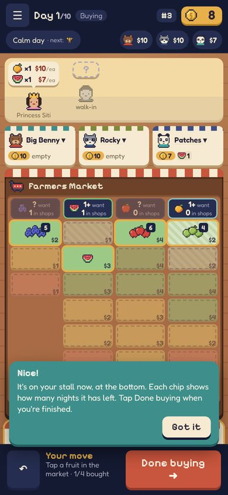
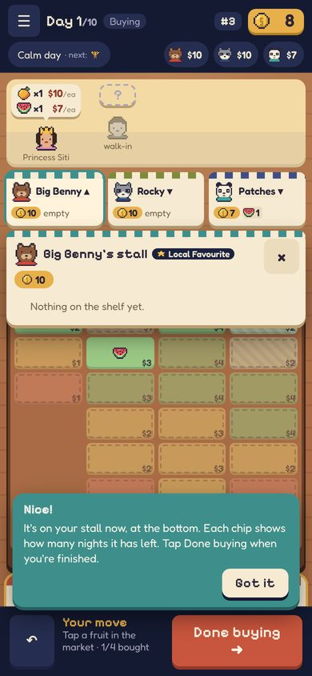
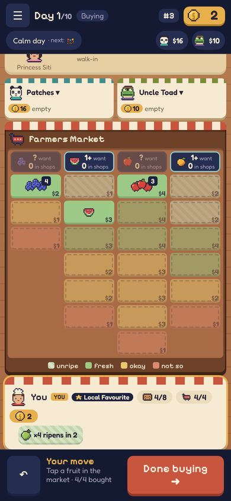
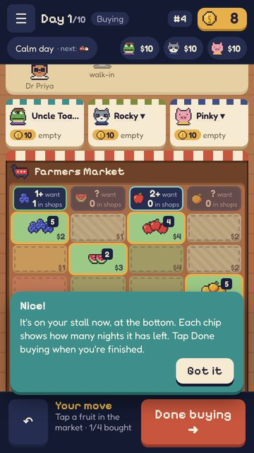
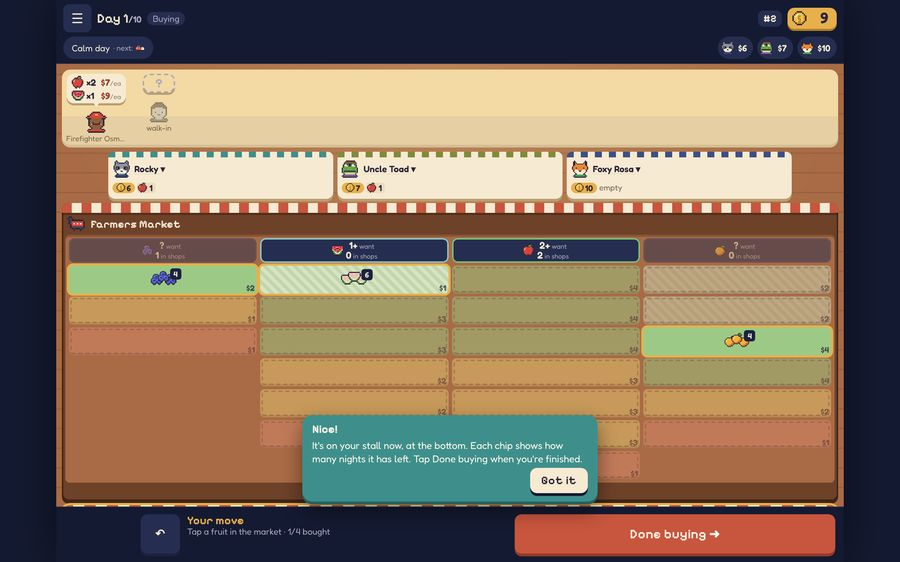

# REP-023 · PLAN-009 built: seated rivals and the new market board

| | |
|---|---|
| Game | Fruit Market |
| Report date | 2026-10-27 02:19 (Asia/Kuala_Lumpur) |
| Package | PLAN-009, approved ("yes" to REP-022) |
| Branch | `workflow/plan-009`, commit b2b495a. **Not on the preview or the live game yet** |
| Delivery status | Verified |

## What changed in the game
- **Rivals sit across the table** in one row: portrait, name, cash and what they hold.
  Tap a seat and their stall drops down as **freshness chips**, the same as your own.
- **The market is the centre:** full width, one column per fruit, newest at the top,
  every slot coloured by freshness, with a colour key. Each column starts with its
  **want / in shops** chip.
- **Your stall** shows chips such as "×4 ripens in 2" or "3 nights"; a red "!" marks fruit on its last day.
- Tutorial and how-to text updated for the new board. Rules, saves, server and online play are unchanged.

## Screenshots

## Validation
| # | Check | Result |
|---|---|---|
| B1 | Quick checks (lint, types, 73 unit tests, build) | PASS |
| B2 | Full browser tests (solo, speed budget, online with a leaver, quick match, four players, reconnect) | PASS |
| B3 | Board slots and prices match the rules (30 games) | PASS |
| B4 | Want / in-shops numbers unchanged (30 games) | PASS |
| B5 | 2, 3 and 4 players on small phone, phone and desktop: no sideways scroll or errors | PASS |
| B6 | Rival drop-down shows only public stock; secret-price leak check 0 | PASS |
| B7 | Rules, saves, server untouched | PASS |

## Notes
- On small phones the table scrolls to reach your stall (as planned). Long names shorten ("Uncle Toa…") with three rivals on the smallest phones.
- Pricing, reveal and evening still use today's panels; that is PLAN-011. The lorry is PLAN-010.

## Next
1. Press **Deploy LIVE game** for 1.1.1 and tell me "deployed". Then I can merge this to `main`, which puts it on the **preview** for you to try.
2. Lorry art choice for PLAN-010: your Gemini picture, or a pixel lorry in the game's style.
