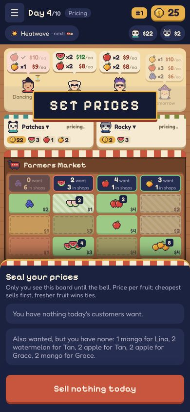
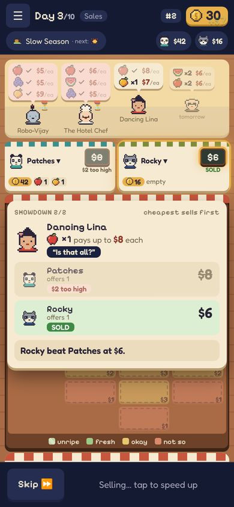
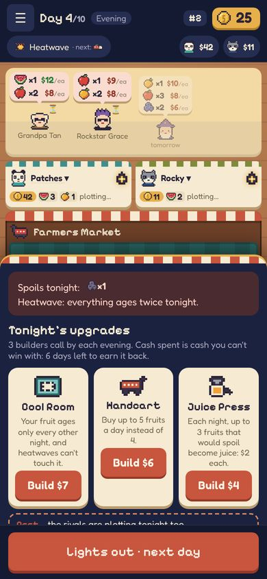
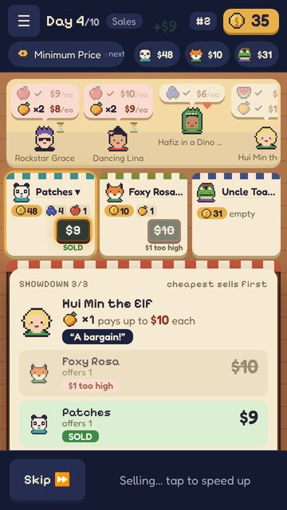
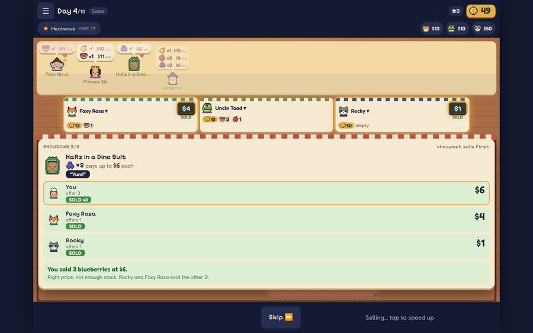

# REP-024 · PLAN-011 built: pricing, reveal and evening on the table

| | |
|---|---|
| Game | Fruit Market |
| Report date | 2026-10-27 02:51 (Asia/Kuala_Lumpur) |
| Package | PLAN-011, approved ("use the gemini lorry, approve PLAN-011") |
| Branch | `workflow/plan-009`, commit 4408cd8. **Not on the preview or the live game yet** |
| Delivery status | Verified |

## What changed in the game
- **Pricing:** each rival's seat shows "pricing…", then a sealed board once they're done. Nobody sees a price.
  Your panel says **Seal your prices**, with a "Psst…" read of the competition, and the button says **Seal my prices**.
- **The reveal happens on the table:** the boards flip open on each seat and on your stall, highest price first.
  The winner's seat glows, and tags like **SOLD** or **$1 too high** sit under the boards.
  If a rival undercuts you, the card says **Outfoxed!**
- **Evening:** lanterns and "plotting…" on the rival seats, and the market crates are covered for the night.
  Favour cards sit under **Up your sleeve**, with a "Psst… the rivals are plotting tonight too."
- **Old small fixes (PLAN-007, now closed):** "You offer" instead of "You offers", money pop-ups stay on screen,
  and the showdown card scrolls instead of being cut off.

## Screenshots

## Validation
| # | Check | Result |
|---|---|---|
| T1 | Full browser tests incl. secret-price leak check 0; screenshots at 3 sizes, no sideways scroll | PASS |
| T2 | Quick checks (73 tests, lint, types, build) | PASS |
| T3 | Rules, saves, server and online protocol untouched | PASS |
| T4 | PLAN-007 fixes | PASS |

## Not done
- The customer walking over to the winner (from the mockup) is not built. Fruit and coins already fly between the stall and the customer.
  It can follow later if you want it.

## Next
1. **Deploy 1.1.1** (Actions → Deploy LIVE game → `PUBLISH`) and tell me "deployed". Then I merge the new look to `main`, and it appears on the **preview** for you to play.
2. Approve **PLAN-010** (the lorry with your Gemini picture). It's the last piece before 1.2.0.
