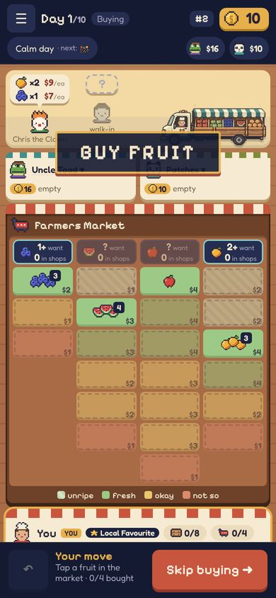
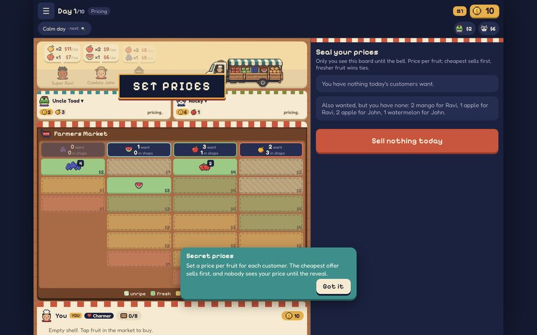

# REP-026 · PLAN-010 built: the farmer's lorry

| | |
|---|---|
| Game | Fruit Market |
| Report date | 2026-10-27 07:54 (Asia/Kuala_Lumpur) |
| Package | PLAN-010, approved ("approve") |
| Build | commit bc2e760, merged to `main` for the preview |
| Delivery status | Verified |

## What changed
- Each morning your Gemini lorry drives into the street and parks; the customers step aside.
- The delivered fruit flies from the lorry into its own slot on the market board.
- When buying ends and pricing starts, the lorry drives off. On "Lorry Breakdown" days it doesn't come.
- It's quick (about 1 second to arrive) and never blocks play. Tapping speeds the unloading; reduced-motion turns the driving off.

## Validation
| Check | Result |
|---|---|
| Quick checks (73 tests, lint, types, build) | PASS |
| Full browser tests incl. speed budget and secret-price leak check 0 | PASS |
| Phone and desktop screenshots, no sideways scroll or errors | PASS |
| Rules, saves, online play untouched | PASS |

## Next
All of the new look (PLAN-009, PLAN-010, PLAN-011) and the Patches rename are on the preview.
When you're happy, say **PREPARE RELEASE** and I'll set up 1.2.0 for you to publish.
