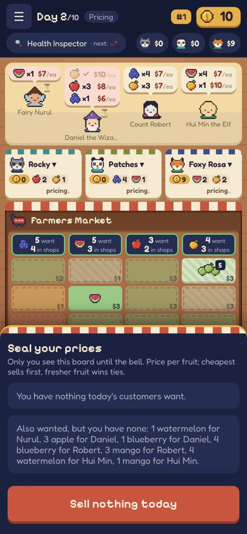
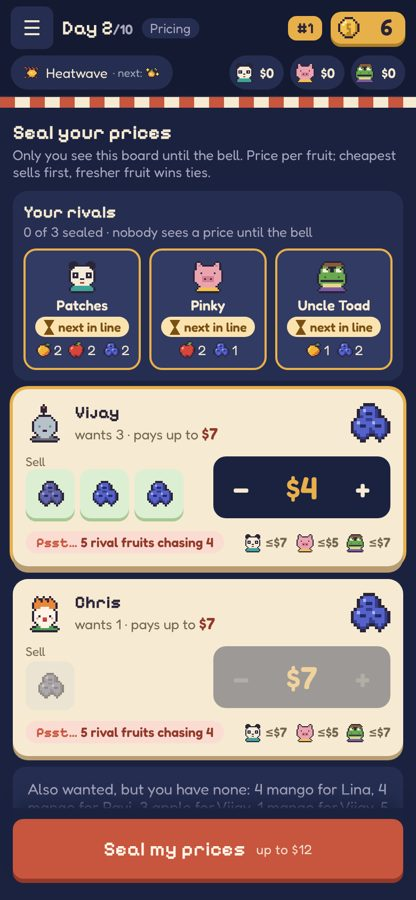
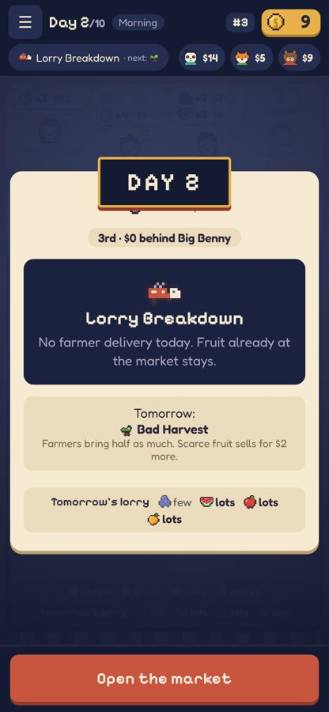
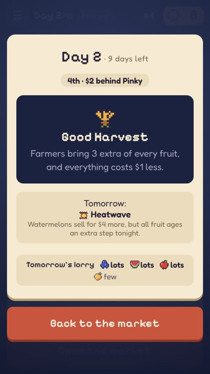

# REP-029 · PLAN-013: full-screen pricing and event sheets, clearer rivals while pricing

| | |
|---|---|
| Game | Fruit Market, rules version 3 (branch `workflow/plan-013`) |
| Report date | 2026-10-27 12:25 (Asia/Kuala_Lumpur) |
| Type | UI only. No rule, balance, server or protocol change |
| Owner request | "edit the UI/UX so that 1. secret price and events pops up to fill the screen (instead of just the bottom half of the screen 2. rework the rivals indicator during secret price, now its not clear still" |
| Approval status | Approved (PLAN-013). Publishing needs its own approval |

## What changed

1. **Pricing fills the screen.** On phones the "Seal your prices" sheet now covers everything below the top bar.
   It was the bottom half before. Desktop keeps its side panel.
2. **Events fill the screen.**
   - The morning card (day, standing, today's event, tomorrow's event, tomorrow's lorry) opens as a full-screen sheet.
     "Open the market" stays at the bottom.
   - Tapping the event chip in the top bar opens the same full-screen view, with "Back to the market".
3. **"Your rivals" strip at the top of the pricing sheet.** Each rival gets one card showing:
   - their portrait and name;
   - a clear status: **sealed** (green, wax seal), **deciding** (amber, a person still choosing) or **next in line**
     (amber, a computer, which always prices after the people at the table);
   - the fruit they hold that today's customers want, or **sits out** if they have none.

   A summary line reads, for example, "1 of 3 sealed · nobody sees a price until the bell".
4. **Seat badges** use the same words and colours: a larger amber "deciding" or "next in line" pill, and a "sealed"
   label under the wax seal.

Only public facts are shown: whether a shop has sealed, and the stock that is already visible on its stall. No price is
shown before the bell.

## Before and after (390×844)

## Checks

| Check | Result | Evidence |
|---|---|---|
| `npm run verify` | PASS | exit 0: records, lint, types, 81 unit tests, build |
| `npm run verify:full` | PASS | exit 0: solo game, BUDGET OK, online 40 pricing frames with 0 price leaks, computer takeover, quick match, four players, reconnect 5 cycles 0 failed |
| Screens at 390×844, 360×640, 1280×800 | PASS | no sideways scroll, no page errors |

## Code

- `src/ui/Game.tsx`: the morning card moves into a full-screen sheet, the pricing tray gets the full-screen class, and
  seat boards record computer rivals.
- `src/ui/panel.tsx`: new `RivalWatch` strip.
- `src/ui/game/panels/Popovers.tsx`: full-screen event view.
- `src/ui/table.tsx`: seat badges.
- `src/ui/styles.css`: PLAN-013 block.
