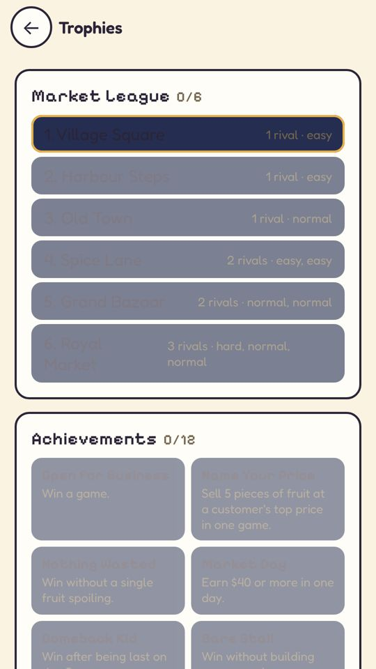
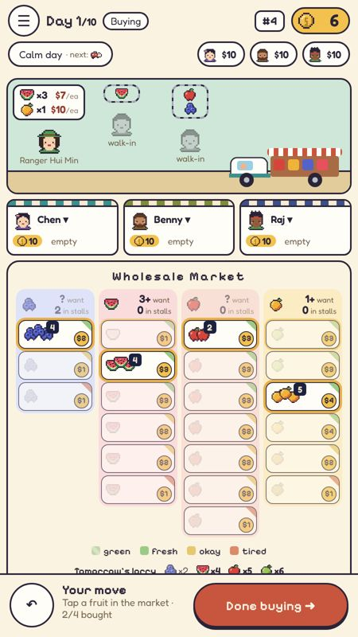
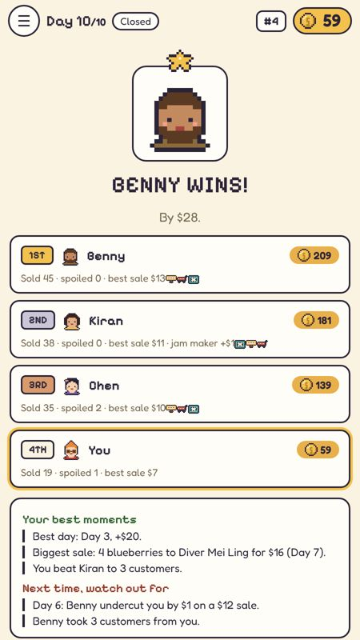
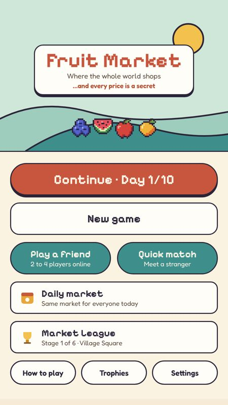

# REP-078 · PLAN-037 release tools: Windows records fix, store screenshots, itch.io build, Play test kit

| | |
|---|---|
| Game | Fruit Market (rules version 5; live unchanged at 1.1.1; preview unchanged) |
| Report date | 2026-10-29 04:00 (Asia/Kuala_Lumpur) |
| Type | Delivery. **Tooling and docs only** (no game change) |
| Request | "Fruit-Market package: Fix the Windows records.mjs bug, retake store screenshots, add an itch.io web build, Play closed-test tester kit. On a branch only, no deploy" and "Yes, branch only" (2026-10-29 02:51) |
| Package | PLAN-037, DEC-047 |
| Build | Branch `workflow/plan-037-release-tools`, started from `main` @ `3d775c6` and rebased on `main` @ `5977d79` (the overnight PLAN-033 restyle, DEC-046, REP-075 to REP-077); pushed, not merged, no pull request |
| Live game | **Unchanged.** Nothing deployed; nothing uploaded to Google Play or itch.io |

## STATUS

Implemented on the branch. Windows fix, itch.io build and Play kit are done and checked. Store screenshots: 6 of 7 retaken; Trophies is blocked by a contrast problem (below). Windows itself is NOT RUN (no Windows machine here). Numbering note: a parallel overnight session took DEC-046 and REP-075 to REP-077 on `main` while this package was being built, so this package is DEC-047 and REP-078.

## 1 · Windows bug in `npm run records`

**Cause.** `records.mjs` found the repo with `new URL('..', import.meta.url).pathname`. On Windows that gives
`/C:/Users/…` (a slash before the drive letter) and `%20` for every space, which no Windows file call accepts.
The same line also breaks on Linux or macOS when a folder name has a space; that is how the bug was reproduced
here. A second problem waited behind it: Git for Windows usually checks files out with CRLF line endings, so
`records:check` would always have said the register was out of date.

**Fix.** A small helper, `scripts/paths.mjs` (`fileURLToPath`, `path.join`, LF comparison), used by
`records.mjs`. Regression tests in `tests/script-paths.test.ts`: the Windows path conversion, a copy of the
records in a folder with spaces, and a CRLF checkout. The folder-with-spaces test fails with the old script.

**Other scripts.** `scripts/with-server.mjs` had the same "am I the main script" check (fails on Windows), started
`npx` without a shell (fails on Windows) and stopped the server with a POSIX-only call. Fixed: shell on Windows
only, `taskkill` on Windows. `npm run test:reconnect` used POSIX quoting (`'…$BASE_URL…'`), which cmd.exe passes
through literally; it now uses `@BASE_URL@` and `@E2E_OUT@` placeholders. Linux behaviour is unchanged
(checked with a short reconnect run). `palette.mjs` already handled Windows. `e2e.mjs` runs commands through
the system shell and should work as is; not tried on Windows.

**PDFs.** They need pandoc (or `PANDOC=<path>`) and the Playwright Chromium. Without pandoc, `npm run records`
still writes DECISIONS.md, CHANGELOG.md and the STATE block, keeps the last good PDFs, says so, and now also
says how to skip PDFs: `npm run records -- --no-pdf`. It still exits with an error so a missing PDF is never
silent. pandoc was available here, so the PDFs in this branch are regenerated (see Changelog).

## 2 · Store screenshots

`scripts/store-shots.cjs` still followed the old game (a perk card at the start) and timed out after the home
screen. Updated for the current flow: shopkeeper picked on the set-up screen, help bubbles off, stocking told
apart from pricing, the evening banner allowed to clear, CSS animations finished before each picture (no coin or
"+$" label caught mid-flight), and a clear error if a picture is missing. New command: `npm run store:shots`.
Two runs give the same pictures (visual diff 0.00–0.45%).

| File | Old | New | Committed |
|---|---|---|---|
| 1-home | old dark look | look D home | **Yes** |
| 2-traits → 2-characters | perk card (no longer in the game) | shopkeeper picker, six human shopkeepers | **Yes** (2-traits removed) |
| 3-buying | animal shopkeepers, robot customer | human cast, look D | **Yes** |
| 4-pricing | animal cast | look D price tray | **Yes** |
| 5-showdown | animal cast | human cast, look D | **Yes** |
| 6-upgrades | animal cast | look D evening tray with upgrades | **Yes** |
| 7-trophies | old dark look, out-of-date league list | league names and locked titles unreadable | No, old kept |

Before the rebase, the first retakes of 4 and 6 had dark headings on a dark tray; `main`'s PLAN-033 restyle
(`e0f2592`) fixed that, so they were retaken after the rebase. Trophies is still affected:

**Finding (game look, not fixed here).** On Trophies the league stage names and the locked achievement titles
are dark text on grey or navy. Also seen in the screenshots: the customer bubbles are cut off at the right edge
of the street, and on the price tray the "ring the bell" note on the red button is faint. These belong to
PLAN-033 (look D, in progress). When Trophies is fixed, run `npm run store:shots` and commit `7-trophies.png`.

## 3 · itch.io web build

`npm run build:itch` → `release/itch/fruit-market-web.zip` (221 KB: `index.html` at the root with everything
inlined, plus the icon) and `release/itch/version.txt` (`1.1.1+<commit>`) for `butler --userversion-file`.
No new dependency (the zip is written with Node's zlib). `release/` is not committed.

**Online on itch.io: off.** The single-file build already never contacts a server. The itch build also clears
`VITE_SERVER_URL`, so a server address set on the computer can't slip in (checked: with it set, the address is
absent from the zip). Reasons, in DEC-047: invite links would point at itch.io's frame, the room server would
get calls from another site, and the privacy note and counters would need a check. Solo, pass-and-play, league,
trophies and the daily market work; the daily leaderboard says it needs a connection; *Play a Friend* shows
"Online play needs the web version or a configured server. See ONLINE.md." Nothing hangs, but players can't
read ONLINE.md: hiding those buttons on offline copies is a small UI change for a later plan.

**Check.** `scripts/itch-smoke.cjs` reads the zip, serves it from one address and embeds it in a frame on
another (as itch.io does), starts a solo game, plays to the first evening (or the results with `--full`), and
reopens the page to see **Continue**. Result: PASS both ways, no page errors, no requests outside the zip.

  

`docs/ITCH.md`: page settings (Kind HTML, embed 450 × 800, mobile friendly portrait, fullscreen button, click to
play), butler push, what to check. `.github/workflows/itch-build.yml`: manual start only, no secrets, builds and
checks the zip and keeps it as an artifact; the butler upload step is commented out with instructions. GitHub
shows the button only after the file is on `main`.

## 4 · Google Play closed-test kit

`docs/PLAY-CLOSED-TEST.md`. Google's rule, read 2026-10-29: personal developer accounts created after
13 November 2023 need a closed test with at least 12 testers opted in continuously for at least 14 days; then
"Apply for production" on the Dashboard (questions on the test, the game and readiness; review usually 7 days or
less). The kit has the Play Console steps, recruitment and tester messages in English and Bahasa Malaysia
(WhatsApp-friendly), the OWNER-BRIEF bug template for feedback, a tracking table and what to submit after
14 days. It links to PUBLISHING.md and store/listing.md instead of repeating them.

**Noticed in store/listing.md (not changed):** the summary says "Data safety: No data collected", but the data
safety section below it lists collected data (leaderboard names, anonymous counters); the section is the one to
use. The description still says "Pick a merchant trait at the start of every game"; it is now a shopkeeper with
a fixed perk. Worth updating before the listing goes live.

## VALIDATION

| # | Check | Result | Evidence |
|---|---|---|---|
| T1 | records from a path with spaces or a drive letter, CRLF checkout | PASS | 6 tests; old script fails with `ENOENT … /tmp/fm%20records%20…` |
| T2 | records on the owner's Windows computer | NOT RUN | No Windows machine here |
| T3 | test:reconnect / local server without POSIX-only handling | PASS (Linux) | `RECONNECT OK: 3 cycles`, server stopped |
| T4 | PDF needs stated; clear behaviour without pandoc | PASS | See §1 |
| T5 | store-shots works and is repeatable | PASS | Visual diff between runs 0.00–0.45% |
| T6 | All store screenshots current and readable | FAIL | 6 of 7 done; 7-trophies blocked by the contrast finding |
| T7 | itch zip: index.html at root, no server | PASS | `unzip -t` clean; server address absent |
| T8 | itch zip plays in a cross-origin frame; save survives | PASS | ITCH SMOKE OK (evening and full game) |
| T9 | itch workflow manual, no secrets, no upload | PASS | By reading the file; not run on GitHub |
| T10 | Play kit with Google's rule and source | PASS | support.google.com …/answer/14151465 |
| T11 | `npm run verify:full` | PASS | Local on `52e75b4` (rebased), 04:04–04:17, exit 0: records, lint, types, 136 unit tests, build, solo game, performance budget, online match with a leaver (0 leaks), quick match, four players, rejoin (5 cycles). Also passed before the rebase |
| T11 | `npm run verify` on the final commit | PASS | Re-run after `npm run records`, exit 0 |
| — | GitHub CI | NOT RUN | Runs when you open a pull request |

## RISKS AND COSTS

Cost RM0. No new dependency, account or secret. Windows behaviour is reasoned and unit-tested, not run on
Windows. The commented butler step uploads to itch.io if someone uncomments it and adds a key: that is
publishing and needs your approval. Regenerated PDFs (pandoc was available here) make the branch about 5 MB larger.

## NEXT ACTION OR APPROVAL

1. On your Windows computer: check out the branch, run `npm ci`, `npm run records:check` and `npm run records`
   (without the patched copy). Tell Claude PASS or the error.
2. Review the branch on GitHub, open a pull request, let CI run, merge when green.
3. Decide later, separately: upload to itch.io (publishing), start the Play closed test, and fix the dark-on-dark
   headings in PLAN-033 so all seven screenshots can be retaken.
