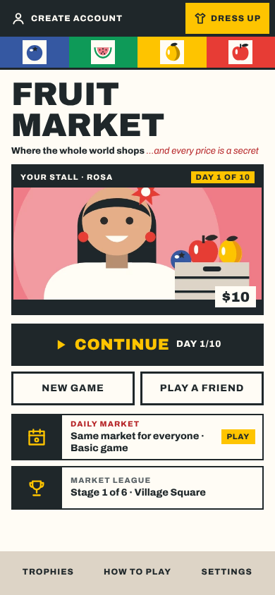
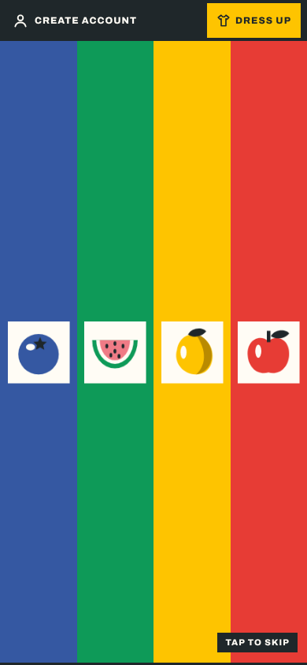
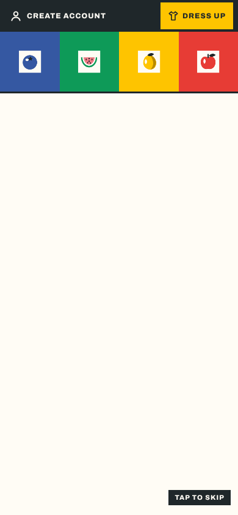

# REP-097 · Home screen A (Ticket Booth) and the Lane Drop opening

| | |
|---|---|
| Game | Fruit Market 1.18.0 (release candidate) |
| Report date | 2026-11-11 11:10 (Asia/Kuala_Lumpur) |
| Type | Build report |
| Request | Three home screen mockups to fit the 1.17.0 redesign; then "go with A but incorporate the fruit design used in design C ... but dont make it too big", three opening ideas; then "ok go with A, and opening 1, but use the fruit icons currently used in game, push it to live" |
| Approval | Build and publication approved by the last message (DEC-083, PLAN-074) |
| Build | Branch `ccr-d8bcd65d-gblqqb` |

## 1. What was chosen

The mockups (a design canvas, outside the repo) showed three homes, A Ticket Booth, B Today's Market and C Market Poster, and three openings, 1 Lane Drop, 2 Ticket Print and 3 The Bell. The owner chose **home A** with C's fruit band kept small, and **opening 1**, drawn with the fruit icons the game already uses.

## 2. The home screen

Top to bottom, in the game table's colours, type and square corners:

1. Black bar: Create account (or "Hi, name"), Dress up in mustard.
2. The four fruit lanes (blueberry, watermelon, mango, apple), 44 px tall with a 3 px ink rule; each fruit is the game's icon on a paper square.
3. "Fruit Market" in the display type, with "Where the whole world shops …and every price is a secret".
4. Your stall: your shopkeeper's picture under a black name strip; with a game waiting, the day (mustard) and your cash.
5. One black button: Continue with the day when a game is waiting (New game and Play a friend below it), else New game (Play a friend below).
6. Daily market and Market League as tickets, then today's top stalls when the board has any.
7. Trophies, How to play and Settings on a kraft strip.

Every button and pop-up does what it did before. Wide screens show the same column, 520 px wide.

## 3. The opening, Lane Drop (about 2.45 s)

| Time | What happens |
|---|---|
| 0.0 s | The four lanes drop down the screen, one after another, under the black bar |
| 0.5 s | A big fruit pops into each lane |
| 1.3 s | The lanes fold up into the band |
| 1.8 s | The title stamps in; your stall and the buttons rise |
| 2.45 s | The overlay fades; the home is already in place |

Tap anywhere to skip. With reduced motion the finished home shows still. The opening waits (at most 1.2 s) for the stall picture and fonts, as before. Automated browser tests skip it, as before.

 

## 4. Checks

| Check | Result | Evidence |
|---|---|---|
| `npm run verify` | PASS | 437 tests, 1 skipped (as before); lint, types, palette, records, build |
| Browser tests | PASS | `npm run test:e2e`: solo game, budget, online 0 leaks in 88 pricing frames, four players, reconnect 5 of 5 |
| Look at 390x844, 360x640, 1280x800 | PASS | Screenshots, no page errors |
| Owner phone check | NOT RUN | Owner asked to publish straight away |

## 5. Risks

- Worn looks (Dress up) no longer show on the home; they showed on the old home's stall badge. They still show in the wardrobe and the game.
- The old market street, bunting and lorry are gone from the home.
- `src/ui/marketArt.ts` is no longer drawn on the home; kept for now.
