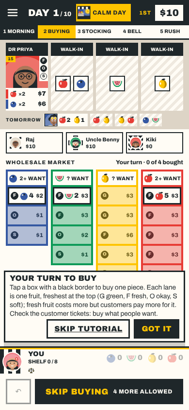

# REP-098 · Rules version 16: tomorrow's queue visible while buying

| | |
|---|---|
| Game | Fruit Market 1.19.0 (release candidate) |
| Report date | 2026-11-11 12:10 (Asia/Kuala_Lumpur) |
| Type | Build report |
| Request | "tomorrow's customer queue should also be visible during the buying phase" |
| Owner's answers | Draw it earlier (a rule change), not a screen-only change. Show it the same as the evening strip: the regular face up, walk-ins face down. |
| Approval | Build and publication: "push it live ASAP" (DEC-084, PLAN-075) |
| Build | Branch `ccr-d8bcd65d-gblqqb` |

## 1. The rule

Under rules 15, tomorrow's crowd was drawn only when buying ended, so nobody could see it while buying. Under rules 16:

1. **Each morning**, with tomorrow's lorry card, draw tomorrow's regular face up and tomorrow's walk-ins face down (fruit on the back only).
2. **While buying**, everyone sees today's crowd (as before) and the Tomorrow strip.
3. **When buying ends**, today's walk-ins turn face up and the Tomorrow strip stays as it is; it becomes the next day's row.
4. Nothing is drawn for the day after the last day.

Unchanged: tomorrow's event changes tomorrow's walk-ins on its own morning; Gossip still looks at tomorrow's walk-ins in the evening; Scout at one of today's while buying; Farah's Sharp Ears peeks when buying ends.

## 2. In the app

The slim Tomorrow strip under today's tickets now shows during the morning and buying too (before, it appeared only after buying).

## 3. How it is built

- Engine: two new fields, `nextForecast` and `nextQueue`, drawn in the morning (`startDay`) and moved into `forecast` and `queue` when the crowd arrives (`customersArrive`).
- Online: the server sends tomorrow's walk-ins face down, as it does today's (`redact`).
- `RULES_VERSION` 15 to 16: unfinished rules 15 games cannot be resumed; the daily board starts fresh (key `r16:a4`); phones on 1.18.0 must update to play online.

## 4. Checks

| Check | Result | Evidence |
|---|---|---|
| `npm run verify` | PASS | 442 tests, 1 skipped; lint, types, palette, records, build |
| Rules 16 tests | PASS | `tests/rules16.test.ts`: every day of an 8-day game; none after the last day; face down online |
| Buying screen at 390x844 and 360x640 | PASS | Screenshots, no page errors |
| Browser tests (0 leaks) | In CI | `verify:full` on main runs before publishing |
| Balance report | NOT RUN | Running at publication; owner asked to publish as soon as possible |
| Owner phone check | NOT RUN | |

## 5. Risks

- Computer players do not use tomorrow's crowd when they buy, so a person who plans ahead gains on them.
- More to read on a small phone during buying (the strip takes one short row).
- The printed kit is not updated.
