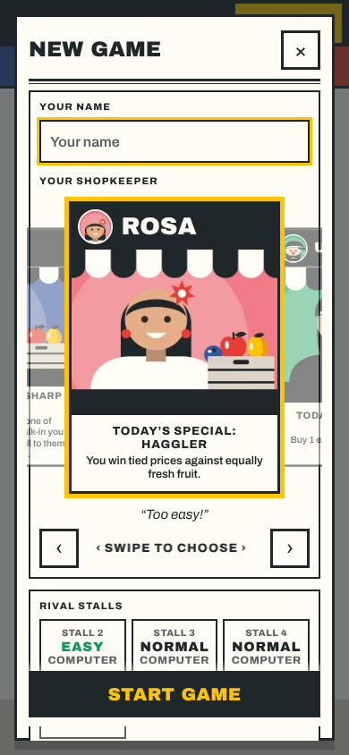
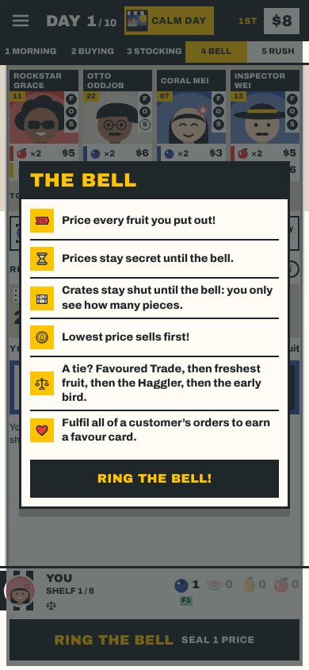
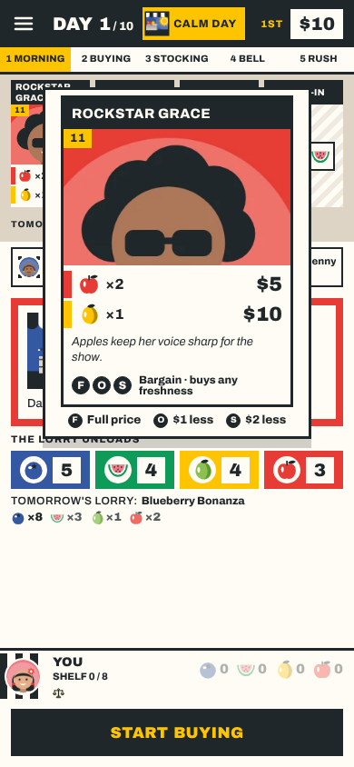
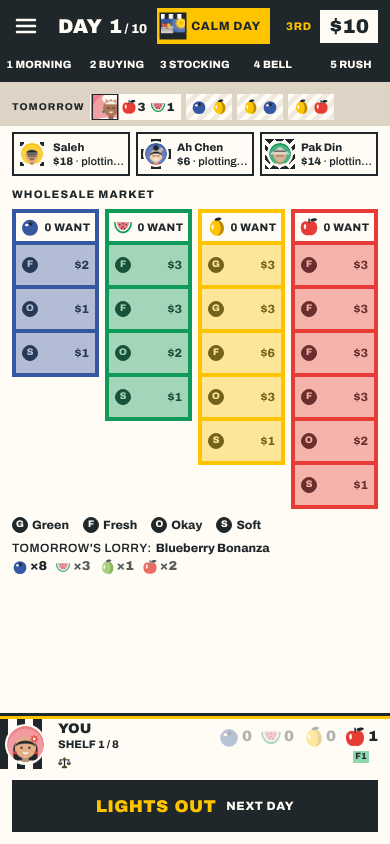

# REP-099 · Owner fixes: pop-ups in the new look, centred news, slower night, evening market, simpler ticket

| | |
|---|---|
| Game | Fruit Market 1.19.0 + PLAN-076 (not released) |
| Report date | 2026-11-11 20:25 (Asia/Kuala_Lumpur) |
| Type | Build report |
| Request | "fix below items first, will revisit this later": full screen, New game and the bell pop-up still in the old design; today's news not centred; slower fruit ageing, the wholesale board shown before Lights out and the night after every player has tapped it; repeated "Everyday: buys…" on customer cards, the long price sentence as a legend |
| Approval | Building approved by the request (PLAN-076). Publishing: not requested, not done. |
| Parked | The pricing screen's standing-order wording and the $3 price limit (the owner will revisit) |

## 1. What changed

| Item | Before | Now |
|---|---|---|
| Play full screen?, Paused, Continue, Play a friend | Rounded boxes, red pill button | Square ticket boxes; one black button with mustard type, the rest outlined |
| New game | Rounded panels, wood-framed shopkeeper sign, red Start game | Square panels and buttons; each shopkeeper card a ticket (black name bar, picture, perk box); square arrows; black Start game |
| The Bell | A pinned paper notice with a red banner and rounded rows | Black "The Bell" title bar, a ruled list with mustard icon squares, a black button |
| Today's news (top bar) | Content at the top of the screen | In the middle of the screen |
| The night | Each piece slid in 0.9 s | Each piece slides in 1.5 s after 0.6 s; spoiled fruit drops after 3 s |
| The evening | The evening panel covered the market, even with nothing to choose | The market stays in view until you tap Lights out, with tonight's warning on it; the panel covers it only for a choice (an upgrade, Shade Cloth, an evening favour); after Lights out the crates are covered until every stall is done, then the night plays |
| A customer's large ticket | "Everyday · buys fresh or okay" twice, and a long sentence ending "Tap to close." | The ticket's own freshness line, then a key: F full price, O $1 less, S $2 less |

    

## 2. Checks

| Check | Result | Evidence |
|---|---|---|
| `npm run verify` | PASS | 442 tests, 1 skipped; lint, types, palette, records, build |
| On screen at 390x844 | PASS | Screenshots of every item; no page errors |
| Browser tests | See PLAN-076 T3 | `npm run test:e2e` |
| Owner phone check | NOT RUN | Not published |

## 3. Notes

- The night already waited for every stall to finish its evening; what changed is that the market is no longer hidden before you tap Lights out.
- An evening with nothing for anyone to do is still skipped by the rules (the night follows "Close for the day").
- No rule, balance, save or online change.

## 4. Follow-up (2026-11-11 20:40)

Owner: "theres no need for the crates are covered part, animate the flow between the wholesale market and night falls, make it centred".

- The "Crates covered" sign is gone: the market stays uncovered while rivals close up.
- Dusk falls over the Wholesale Market for 0.6 s, then Night falls fades in, in the middle of the screen.
- Found and fixed: tapping Lights out when you were the last stall to close also counted as "hurry up", so the whole night passed in under a second. Now only a tap on the table (not on a button) speeds an animation up. This was likely why the night looked too fast.
