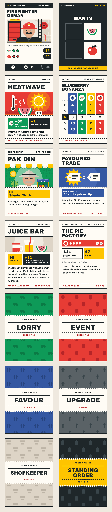
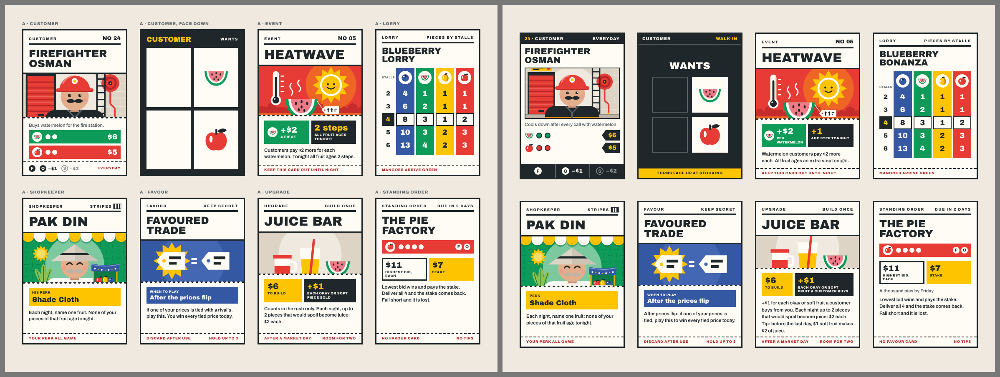
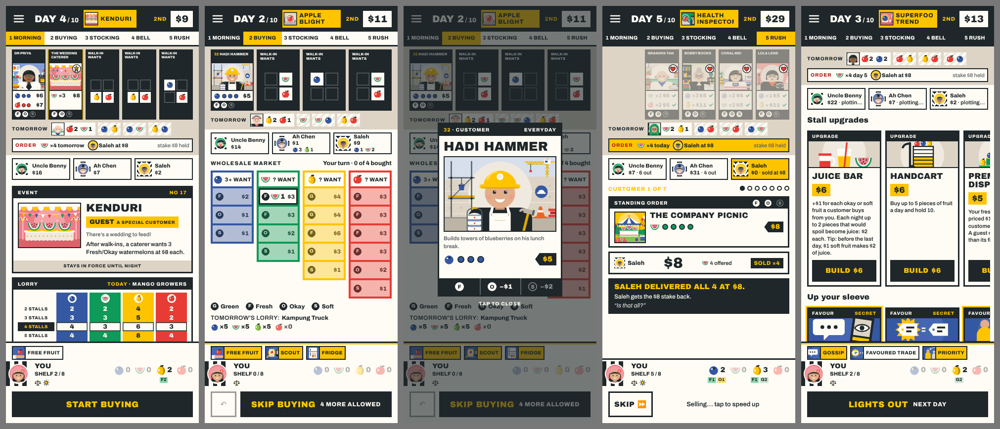
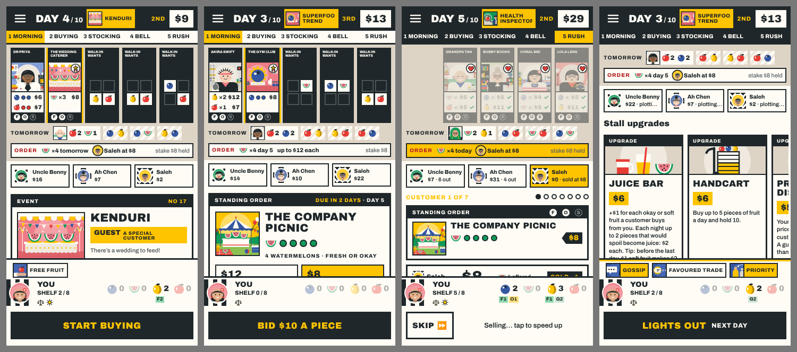

# REP-108 · Release A, package 2: the new cards and pictures in the game; the shared motion blocks

| | |
|---|---|
| Game | Fruit Market 1.19.1 live; rules version 18 on the working branch (not released) |
| Report date | 2026-11-12 (Asia/Kuala_Lumpur) |
| Type | Build and results report |
| Request | PLAN-083 (release A, package 2). Owner: "okay yes" to REP-106, confirmed 2026-11-12: "approve package 2" |
| Approval | PLAN-083 approved and built. Publishing: not requested, not done. |

## 1. What was built

Two helpers worked in separate work folders. I checked each one's work, merged it (`10ef387` cards, `fd95996` motion) and ran the checks again on the two together.

**The pictures.** All 90 new pictures are in the game: 36 customers, 8 standing-order clients, 20 events and Calm Day, 8 shopkeeper scenes, 6 favours, 5 upgrades and 6 back patterns. The 73 old pictures they replace are removed. Each picture has a focus point, so a narrow frame still shows the face or the subject. The picture folder went from 541 KB to 558 KB.

**The cards.** Every card the game draws follows the approved designs: event, lorry, shopkeeper, favour, upgrade and standing order in design A; the customer front and back as approved earlier; the pattern backs; the label "Upgrade". Tapping a customer, a favour or a standing order opens the full card.

Mock-up on the left, the game on the right:

On the phone, 390 by 844 (morning, buying, a customer tapped, the rush, the evening):

On a small phone, 360 by 640 (morning, bid, the rush, the evening):

**The motion blocks.** These are foundations; package 3 builds the screens on them.
- One clock. Every pause and every move takes its length from one list, and one speed setting drives them all (normal, Fast rivals, a tap to hurry).
- One shared move. A piece of fruit or a coin travels in a smooth curve and lands softly. Numbers change when it lands. At most 12 pieces travel at once.
- A sheet. The panel in the middle of the table slides in (0.18 s) and off (0.12 s). The table under it does not move.
- Reduced motion, one rule: nothing travels, but every pause to read stays.
- The performance check now counts slow frames in the rush and the night and fails if they pass 2 in a hundred.

## 2. Where the game's cards differ from the mock-ups

The mock-ups used example wording. The game uses its real data, and a phone has less room than a drawing.

| Card or screen | Difference | Why |
|---|---|---|
| All cards | Names, numbers and sentences come from the game's data ("Blueberry Bonanza", not "Blueberry Lorry"; Heatwave reads "+$2 per watermelon") | The text rewrite is package 4 |
| Customer | The picture is taller on a one-fruit card. Special guests say "Special guest" where the number goes | No blank band; guests are not in the deck of 36 |
| Shopkeeper | "Perk", not "His perk". The stall pattern shows only in the new-game picker; elsewhere "No 01" to "No 08" | The data has no his or her; the pattern belongs to a seat |
| Standing order | The client's one-line quirk sits above the rules sentence | From the data |
| Lorry | A zero is a dim 0. On a day an event changed the load, a "Today" row is added | Clearer |
| Backs | Counts come from the data: "Deck of 12" favours, "5 kinds" of upgrade | Rules 18 |
| Customer tickets in the row | With five or six in the row, or on a phone 360 wide, tickets are narrower than any mock-up: no number, smaller type, "×3" where dots do not fit | Room |
| Rush | On a phone 844 tall the customer card is a compact version. The full card shows on taller screens | The full card pushed the result line off the screen |
| Morning | Needs a scroll when a standing order is open, and always on a phone 640 tall | The old layout; package 3 |
| Bid screen | Part of the order card sits behind the bidding controls until scrolled | The old layout; package 3 |
| Evening | The Build button is inside each offer; a favour opens its full card to play | The old flow; package 3 |
| Not yet shown anywhere | The full event, lorry and upgrade cards are drawn but no screen opens them yet | Package 3 |
| Still the old drawings | The small perk and upgrade icons, and the favour icons in How to play | Not in this package |

New fixed labels that are on no mock-up, for the text package to confirm: "Special guest", "Perk", "Today", "Other fruit arrives okay", "Tap to close", the favour lines "In the evening", "On your buying turn" and "After the prices flip", and the captions under each upgrade's figure.

## 3. Changes beyond the plan, for the record

- **Tests rewritten.** `tests/cards.test.ts` pinned the old card markup, which no longer exists. It now has 32 tests on the new cards, including one that fails if any card in the data lacks its picture file or a file is left unused.
- **Today's lorry.** The game's state does not store which lorry card was drawn today, so the morning works it out from the delivery. A new test shows it never names the wrong lorry (5 table sizes, 12 seeds, 10 mornings) and names one more than 90% of the time. When it cannot be sure it shows the load without a name. Storing the card would be simpler but changes the saved game and the online messages, so it needs its own approval.
- **Small repairs made while building the motion blocks:** the day's takings card flashed for two frames before the bell from day 2; the rush card started 140 px to the right of the customer's ticket; the "FINAL DAY!" stamp and the labels over a stall were lost with reduced motion. All four are fixed.
- **The performance script** no longer polls the page during the rush and the night, so the frames it counts are the game's own.
- No rule, balance, save or online change. No new library. No test disabled.

## 4. Checks

| Check | Result | Evidence |
|---|---|---|
| `npm run verify` on the two together | PASS | Run by me on `fd95996`: 63 test files, 605 passed, 1 skipped (was 545); lint, types, records, build pass |
| Every card has its picture file | PASS | `tests/cards.test.ts`, part of verify |
| `npm run test:e2e` on the two together | PASS | Run by me on `fd95996`: solo game to the results with no errors; budget OK first try; online match, 82 pricing frames, 0 leaks; rematch; quick match; reconnect 5 of 5; "E2E OK" |
| Cards beside their mock-ups, 390 by 844 | PASS, differences in section 2 | By me: 26 screenshots from saved games on `fd95996`, no page errors, and the cards drawn on one page |
| Cards beside their mock-ups, 360 by 640 | PASS, differences in section 2 | By me: 26 screenshots on `fd95996`, no page errors. The cards fit; three old layouts do not (section 5) |
| Pass-and-play: no price of the first person shows on the hand-over screen | PASS | By me, in a browser, two people and two computers: the hand-over screen was up 58 ms after the first person sealed; on all 61 frames with it up, the table and the pricing panel were off the page; the second person saw only their own prices |
| A bought fruit travels and lands without a jerk | PASS | Helper's measurement: 32 frames in 517 ms, no gap over 17 ms, lands 0 px off |
| Reduced motion: nothing travels, pauses stay | PASS | Helper's measurement: 0 frames with a piece in the air; bell 2.9 s both ways |
| A whole solo game, normal and Fast rivals | PASS | Helper: results after 396 s and 210 s, no page errors |
| Performance, before and after | PASS, no clear change | By me, 3 runs each on the old and the new build, same script, processor slowed four times (table below) |
| Performance limits on the CI machines | NOT RUN | CI runs only after a merge to `main` |
| A real phone | NOT RUN | |
| Seen by the owner | NOT RUN | Six pictures sent 2026-11-12; awaiting his word |

**Performance, measured.** Each run plays a whole game with the processor slowed four times. The runs differ from each other more than the two builds do.

| | Before the package (3 runs) | Now (3 runs) | Limit here | Limit on CI |
|---|---|---|---|---|
| Game screen opens in | 126 to 199 ms | 116 to 276 ms | 350 | 600 |
| Longest single piece of work | 96 to 191 ms | 106 to 155 ms | 200 | 250 |
| Elements on the game screen | 504 to 512 | 533 to 540 | 800 | 800 |
| Slow frames in a hundred, rush and night | 0.16 to 0.22 | 0.24 to 0.30 | 2 | 2 |
| Pieces of work over 50 ms in a game | 19 to 31 | 38 to 46 | not limited | not limited |

The page holds about 30 more elements, slow frames are slightly up, and a game has more pieces of work over 50 ms (the sliding panel costs about 40 ms at each change on a processor this slow). All are far inside their limits, and the longest single piece of work is no longer than before. The run inside the browser tests measured 234 ms and 151 ms, within the same spread. The CI machines are slower than this one and have not run this code.

## 5. Found and not fixed

For package 3 (screens):
- **On a phone 640 tall the rush hides the stalls' offers below the screen.** Before this package only the stalls' names showed there; the taller customer tickets now push them off entirely. The rush is the first screen package 3 rebuilds.
- The morning needs a scroll when a standing order is open, and always on a phone 640 tall. Part of the order card sits behind the bidding controls.
- The rush card's way back is cut short and never reaches the ticket.
- When walk-ins turn face up the customer row grows 17 px and the table below drops.
- While rivals bid or act, the middle panel is taken off and redrawn at every step.
- Pop-ups still appear in three steps.
- With first-game tips on, the tip at Stocking and Pricing squeezes the screen.
- On a phone 360 wide the pricing screen is a few pixels too wide.
- Small tap targets: tomorrow chip 26 px, market cell 28 px, favour chip 28 px, event chip 36 px.
- Old card styles are left in four stylesheets; remove them as each screen is rebuilt.

For package 6 (print kit): `scripts/print-deck.ts` stops at its own count check on the rules 18 deck ("favour cards: expected 18, found 12"), and it still uses the old card markup and picture names. It failed the same way before this package.

Housekeeping: `public/art` (2.8 MB of earlier pictures) ships with the game but is no longer used; an existing test keeps it on purpose.

## 6. For the owner

| | |
|---|---|
| **Look at the cards** | Six pictures were sent. Anything to change is cheapest now, before the screens are rebuilt around the cards |
| **The preview copy** | To play this on your phone the branch must be merged to `main`; CI then updates the preview copy (not the live game). I will do that only on your word |
| **Balance (from REP-107, still open)** | Accept for release A and watch Raj and Saleh in playtests (recommended), or tune further now |

Next: package 3, the screens, each with its motion. It is built in parts; the first part is the rush, together with the morning, the standing-order bid and the evening.

One thing I will keep as it is: in the evening the Wholesale Market stays in view until you tap "Lights out", as you asked on 2026-11-11 (PLAN-076). REP-106 suggested the evening could end by itself; your earlier instruction is the more specific one, so the tap stays unless you say otherwise.
