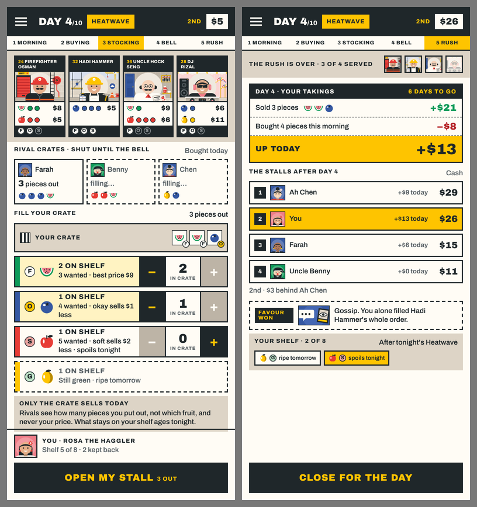
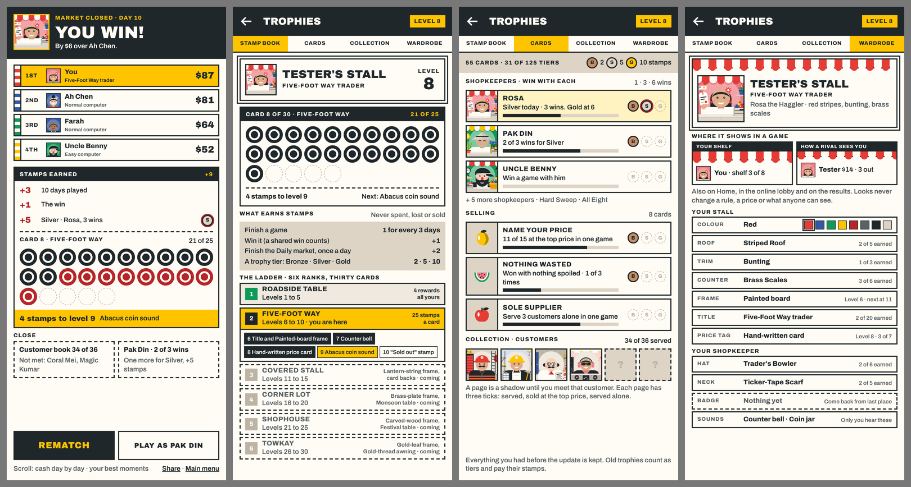

# REP-109 · Mock-ups: stocking, the day's takings, and the stamp book screens

| | |
|---|---|
| Game | Fruit Market 1.19.1 live; rules version 18 on the working branch (not released) |
| Report date | 2026-11-12 (Asia/Kuala_Lumpur) |
| Type | Design mock-ups for approval |
| Request | REP-104 section 4 left stocking, the takings, the results, Trophies and the Wardrobe undrawn. DEC-099 approved the stamp book; the progression study says the looks made visible "need the owner's approval of the mock-up" |
| Approval | Awaiting the owner. Nothing is built from these. |

Design page: https://claude.ai/artifact/TM2aRxtEpQsqxAo1cAK8Cx (the new section is at the top).

## 1. Two screens of the day (for package 3)

| Board | What it shows | What is new against today |
|---|---|---|
| Stocking | Your crate with the pieces in it; one row for each box of your shelf that holds fruit, with how many are wanted and what an older piece loses; green fruit shown but not for sale; which rivals have opened | The same parts as the approved pricing screen, so stocking, pricing and the bell read as one sheet. The rule is unchanged: nothing is out until you add it |
| The day's takings | Sold, bought and what you are up today; every stall's day and cash in order; a favour card won; what tonight does to the fruit left on your shelf | One ledger in place of four coloured lines; every stall's cash shown, not only today's takings |

## 2. The stamp book screens (for package 5)

| Board | What it shows |
|---|---|
| Results | Who won and by how much; each stall with its awning colour; the stamps this game earned, landing on your card; the next reward; two things that are close; "Rematch" and one button that sets up the game the nudge is about |
| Trophies · stamp book | Your stall's name, title and level; the card you are filling; what earns stamps; the whole ladder of six ranks, with nothing hidden |
| Trophies · cards | Trophies as cards with Bronze, Silver and Gold tiers and a progress line; the customer collection, where a page is a shadow until you meet that customer |
| Wardrobe | Your stall and shopkeeper as rivals see them; where the looks show in a game (an awning strip over your shelf and on your box as a rival sees it); every slot with what is earned and how the next is earned |

The numbers, names and trophies in the pictures are examples. The stamp itself is a plain ring here; its real shape is drawn when the screens are built.

## 3. What follows the decisions already made

- The ladder, the stamp values and the first-version list are those of DEC-099 and the progression study (`docs/studio/review-18/PROGRESSION.md`, sections C and G).
- Rewards from level 11 up are shown as "coming"; they arrive in release C.
- Nothing here changes a rule, a price or what anyone can see. Sounds are heard only by you; card backs and table themes are not in this release.
- The weekly goal is not in release A, so the results screen's "close" lines use the collection and the trophy tiers.

## 4. What the owner is asked

1. **Stocking and the takings:** build them as drawn?
2. **Results and Trophies:** is this the right way to show the stamps, the ladder and the tiers? The rank names (Roadside Table, Five-Foot Way, Covered Stall, Corner Lot, Shophouse, Towkay) are yours to reword.
3. **The looks in a game:** an awning strip over your shelf and a thin one on your box as rivals see it. Right, or too much on a small screen?

## 5. Checks

| Check | Result |
|---|---|
| Each board rendered at 390 by 844 and looked at by me | PASS (three did not fit at first and were redrawn) |
| Text against the rules as decided (DEC-086, DEC-099, DEC-101) | Read while drawing; not machine-checked |
| Small phone (360 by 640), six stalls | NOT RUN (not drawn) |
| Built in the app | NOT RUN (awaiting approval) |
