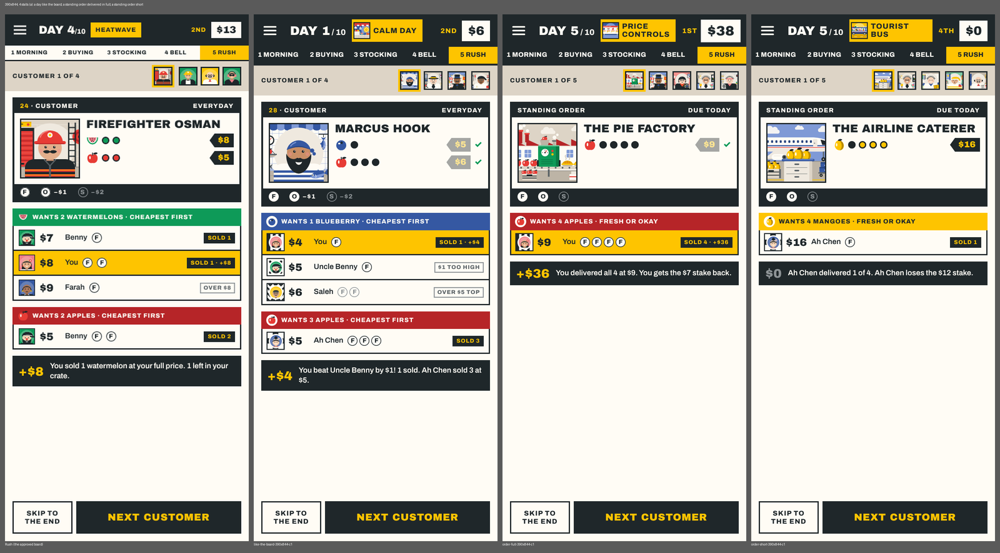
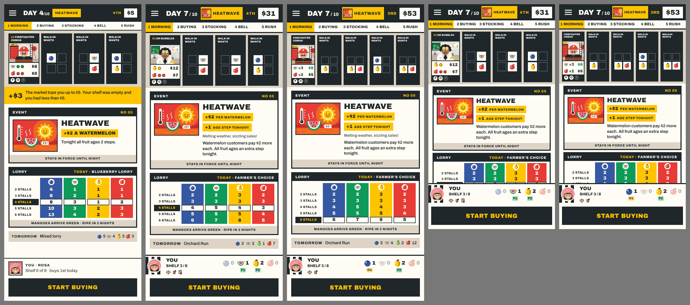
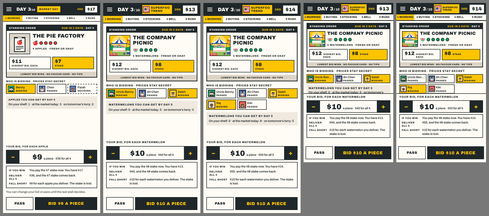
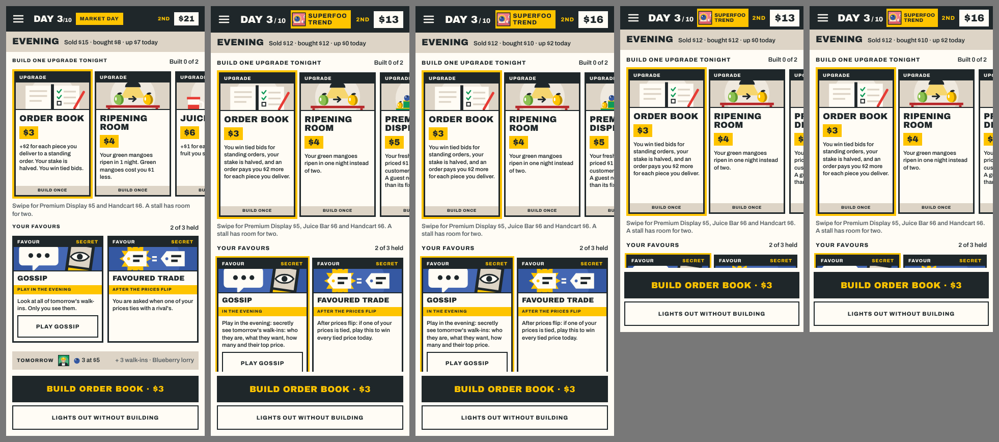

# REP-110 · Release 1.20.0: the core game on rules 18, with the first four rebuilt screens

| | |
|---|---|
| Game | Fruit Market 1.19.1 live (rules version 16); this build is 1.20.0, rules version 18 |
| Report date | 2026-11-12 (Asia/Kuala_Lumpur) |
| Type | Build and results report (PLAN-084), and release preparation |
| Request | Owner, 2026-11-12: "live today but dont need to be exactly at 7pm, settle what else that needs to be settled for the core gameplay mechanism, cards now to publish it live for me to test" (DEC-105) |
| Approval | PLAN-084 approved and built. Publishing 1.20.0: the owner's word above, for today's build, if the full checks pass on it. |

## 1. What goes live in 1.20.0

- **Rules version 18** (PLAN-077, 079, 082): staked standing orders with open bidding, the $5 top-up at dawn, Favoured Trade after the prices flip, all five upgrades on offer at new prices, the $4 green mango, rebalanced shopkeepers.
- **The new cards** (PLAN-083): every customer, event, lorry, shopkeeper, favour, upgrade and standing order redrawn; a tap opens the full card.
- **Flow repairs** (PLAN-081): a waiting game is asked about before it is replaced; trophy names with a space sync correctly.
- **Four rebuilt screens** (PLAN-084, this report): the rush, the morning, the standing-order bid and the evening.

Not in it yet, and following in later releases: stocking, pricing, the bell, the takings, the market and the night in the new look; the rewritten text; the stamp book with Results, Trophies, Wardrobe and Home; the print kit (paused).

## 2. The four screens (PLAN-084)

Each picture shows the approved design first, then the game.

| Screen | What is built |
|---|---|
| The rush | One card for each customer, every stall's offer under it in price order, what you earned, "Next customer" and "Skip to the end". Fruit travels to the customer and coins back. Nothing changes before its customer |
| The morning | One sheet from under the customer tickets to your shelf: the event, today's lorry with your table's row marked, tomorrow's lorry in one line. Coins travel for a top-up or a fine |
| The bid | One sheet from the first bid until the bids are turned over: who is bidding (never a price), three lines on what your bid means, "Pass" beside "Bid $N a piece". The bids turn over together, the winner is shown, the stake lands on the card |
| The evening | Upgrades and favours as cards, one main button, "Lights out" always there. It never ends by itself (PLAN-076) |

## 3. Checks

| Check | Result | Evidence |
|---|---|---|
| `npm run verify` on the merged code (`04d12ed`) | PASS | 65 files, 659 tests passed, 1 skipped |
| `npm run test:e2e` on the merged code | PASS | Solo game to the results with no errors; performance budget OK (longest task 151 ms, 0.5 slow frames in a hundred); online match, 82 pricing frames, 0 leaks; reconnect 5 of 5. Five helpers were using the same machine |
| The screens beside the designs, 390 by 844 and 360 by 640, 4 and 6 stalls, looked at by me | PASS | The helpers' pictures on the merged commits, and my own from the merged build; no control off the screen or covered |
| Nothing shown before its moment; no secret early | PASS | Rush: 20 frame-by-frame runs, 0 problems; pass-and-play 0 problems (helper). Bid: the first person's bid never drawn for the second (helper). Online: 0 leaks (my run) |
| Pace | PASS | Four customers 10.3 s untouched (13.3 s before), 1.6 s tapped through; reduced motion keeps the pauses (helper's measure, not repeated on the merged code) |
| The full checks on the CI machines | NOT RUN | They run when this build is merged to `main`; this branch has never run there |
| A person has played it | NOT RUN | The owner tests it on the live game |

## 4. Where the game differs from the designs

- The game's own bottom strip (your shelf) is kept; the design's "You · Rosa" strip belongs to the table, which is rebuilt next.
- The game's texts are longer than the designs', so a tall morning is drawn closer rather than scrolled.
- Lines appear when they apply: a fine, several top-ups, a final-day note, "No lorry today".
- With 4 or 5 rivals the bidders' chips take two rows.

## 5. Known gaps in this release

- On a small phone (360 by 640) the evening's favour cards and part of the bid card scroll; the buttons stay in view. On 390 by 844 the evening scrolls on a night with favours.
- The first-game tip "Secret prices" lies over the bid's stepper until dismissed.
- While the bids turn over, the strip of the day's steps already shows "2 Buying"; the bottom bar can say "Bought!" during an evening move.
- A sentence can read "You wins: Haggler!" when the stall is named "You" (text package).
- Seven older trophies cannot be earned under rules 18 until the stamp book release; "Serve all 36 customers" counts guests and order clients.
- The longest piece of work on a slow phone is closer to its limit than before (151 ms against 200 ms here); not yet measured on the CI machines or a real phone.
- Stocking, pricing, the bell, the takings, the market and the night are in their earlier layout.

## 6. What a player meets on updating

- A game paused under the old rules cannot be continued; the game says so.
- The Daily market's board starts afresh for rules 18 (boards are kept apart by rules version).
- An Android app already installed keeps the version it was built with; play between versions is refused with a message to update.

## 7. Labels invented for these screens (for the text package)

"The bids", "wins", "You passed", "Stake held", "down $N today", "Your upgrades", "1st"; in the rush "Wants N fruit · fresh or okay", "$0", "End of day N", "Market closed".

## 8. How the work is now organised

The owner asked for speed (DEC-104) and then for the core game first (DEC-105). Four helpers keep building on the working branch, none of it in this release: the sheet from stocking to the takings, the market and the table, the text outside the screens, and the stamp book. The print kit's decks already print on rules 18 on their own branch; that work is paused.
