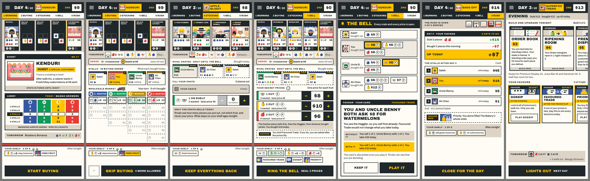
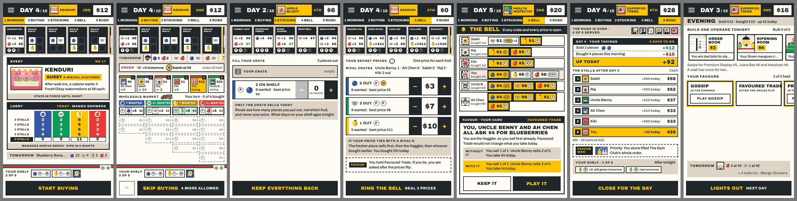

# REP-111 · Release 1.20.0, complete: the whole day rebuilt on the table, and the new text

| | |
|---|---|
| Game | Fruit Market 1.19.1 live (rules version 16); this build is 1.20.0, rules version 18 |
| Report date | 2026-11-12 (Asia/Kuala_Lumpur) |
| Type | Build and results report (PLAN-085; PLAN-088 part 1), and release preparation |
| Request | Owner, 2026-11-12: "build now: Stocking, pricing, the bell, Favoured Trade, takings; Market lanes, stalls, shelf, buying, lorry, night", "publish after everything below is ready", "target so that everything can be ready by 8.30 for tonights release" (DEC-106) |
| Approval | PLAN-085 and PLAN-088 approved and built. Publishing 1.20.0: the owner's word in DEC-106, once every check passes, including the full checks on the CI machines. |

This report adds to REP-110 (the first four screens). Together they describe release 1.20.0.

## 1. What was added since REP-110

| Part | What is built |
|---|---|
| One sheet | A single sheet stays on the table from "fill your crate" to "Close for the day". The market no longer flashes back between the steps. It measures the room it has and draws closer in steps before anything scrolls |
| Stocking and pricing | As on the boards: your crate, a row for each shelf box, the stepper for each price, the tie order in words, the Favoured Trade reminder. Tags turn face down on "Ring the bell" |
| The bell and Favoured Trade | Every stall's prices turn over stall by stall (2.2 to 2.9 seconds; a tap ends the pause). The question comes as its card under the open rows; "Play it" sends the card to the tied price and stamps it |
| The takings | A ledger that always adds up to "Up today", "Down today" or "Even today"; every stall's day and cash; a favour card won; what tonight does to your shelf |
| The Wholesale Market | Lanes of 3, 4, 5 and 6 boxes as on the board. A bought piece travels from its box to the shelf; a rival's whole turn is one move; the lorry unloads a crate into each lane; walk-in cards turn face up one after another |
| The night | The rows stay, dimmed. Every piece slides one box along (two in a Heatwave, none in a Monsoon); a piece leaving the last box tips off. About 2.5 seconds |
| Stalls and shelf | The stalls in buying order with what each bought today; your shelf with what tonight does to each piece; awning strips (DEC-103) |
| The text (PLAN-088, part 1) | Cards, story lines, tutorial and How to play in the plain voice (DEC-087): 299 audit entries applied, 14 rewritten for rules 18. Sentences built from a stall's name now read "You win", "You get the $7 stake back" |
| Two named fixes | On a small phone the bid and the evening no longer scroll |

Two repairs made while merging: a tap in the first half second of the pass-the-phone screen is ignored (a double tap on Done could open the next person's stall); a shelf chip no longer groups two green pieces that ripen into different boxes on a Heatwave night.

## 2. Checks on the release build (`ca39c60`)

| Check | Result | Evidence |
|---|---|---|
| `npm run verify` | PASS | 70 files, 722 tests passed, 1 skipped |
| `npm run test:e2e` | PASS | With the machine quiet: solo game to the results with no errors; performance budget OK (longest task 187 ms against 200, opening the game screen 211 ms, 0.69 slow frames in a hundred, 626 page elements of 800); online match with 66 pricing frames and 0 leaks; an abandoned match taken over by a computer; quick match; four people and two computers; reconnect 5 of 5. |
| Performance on this machine | PASS when quiet | Runs on the merged code: 141 ms and 187 ms with the machine quiet (PASS); 216, 260 and 344 ms while helpers and other tests were loading it (FAIL at the 200 ms limit). The CI machines measured 63 ms on the four-screen build, against their limit of 250 ms. |
| Every screen of the day seen by me at 390 by 844 with 4 stalls and 360 by 640 with 6 stalls | PASS | The two pictures above, from the release build; the helpers' pictures beside each board (stocking, pricing, the bell, the takings, buying, the stalls) |
| The table rows keep their places from morning to night | PASS | Helper's measure: identical row positions at every step of a day at both sizes (before: the customer row grew 20 px and two rows vanished at night) |
| The market does not show between stocking and the takings | PASS | Helper's measure: 0 frames with a lane showing in three runs |
| No secret early | PASS | No rival price before its row turns (9 watched runs); a rival's shelf is drawn the same whatever it holds (test); online leak check above; pass-and-play: 0 frames of another person's shelf with one tap and, after the repair, with a double tap (185 frames, my run; 169 leaking frames before) |
| The same seed gives the same game after the text change | PASS | 277 computer games, 2,892 days, one checksum before and after |
| The full checks on the CI machines | see the records' history | Run after the merge to `main`; nothing is published unless they pass |
| A person has played it | NOT RUN | The owner tests it on the live game |

How it was built: eight helpers in separate work folders, five of them on the screens for about two hours, each with its own files; every piece merged by the session and checked on the merged code (DEC-104).

## 3. Where the game differs from the boards

- "You paid $3 each" is not shown in pricing: the game records the day's total spend, not each piece's cost.
- A stall's box shows its name beside the face and one line of cash and fruit; "3 out" sits in the corner while crates are shut.
- The shelf is two rows on a tall phone (99 px, the board has 65) and one row on a small phone, where chips shorten as the shelf fills.
- The takings can have more ledger lines than the board's two, when the game has them.
- The bell gives the day's totals in "Without it / With it", not a customer-by-customer sentence; a red "FT" stamp lands on the tied price.
- The night has no approved board: it is the lanes on ink under "Night falls".
- On phones 650 px tall or less the customer tickets in the row have no picture, so the six lane boxes fit; a tap opens the full ticket.

## 4. Known gaps in this release

- The strip of the day's steps says "5 Rush" while the bell rings, and "2 Buying" while bids turn over.
- The takings appear a moment before the last coins finish counting.
- A lane box can be as small as 83 by 20 px on a small phone with six stalls, a standing order and a favour card; lane headings are 18 to 22 px tall; favour cards on the shelf are 26 px tall.
- On a small phone an upgrade you cannot afford shows one line and the reason; its whole card cannot be opened.
- At night a box whose piece slid away keeps its solid edge until dawn.
- The first-game tip about buying still describes the old shelf.
- With a sheet on the table at 360 px wide, the first letter of two row labels is hidden.
- RULES.md and the print kit do not yet use the new card wording. The labels on the screens are not yet rewritten (text, part 2).
- Seven older trophies cannot be earned under rules 18 until the stamp book release.
- Old styles and a few unused helpers are left in the code.

## 5. For the owner to read: the new voice

Examples from the game: "You win: Haggler", "You get the $7 stake back.", "Rosa beat you by $2", "You and Ah Chen split the order". Where the text work did not follow the audit, for his confirmation later: the eight shopkeeper lines were shortened, not cut; favour cards no longer begin "Play …"; the Juice Bar's "Tip:" sentence is removed.

## 6. What follows this release

The stamp book with Results, Trophies, Wardrobe and Home (first pass built, paused); the labels on the screens; the print kit (the decks already print on rules 18, paused); the privacy page when the stamp book's counts ship.
