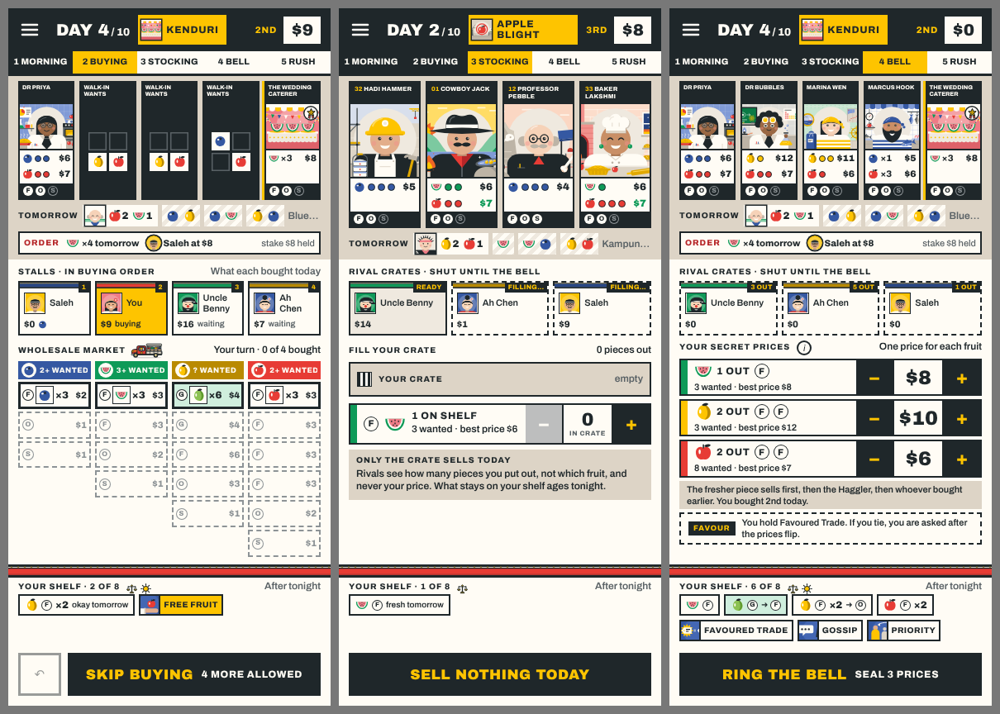
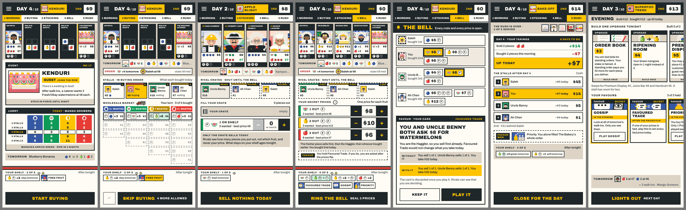
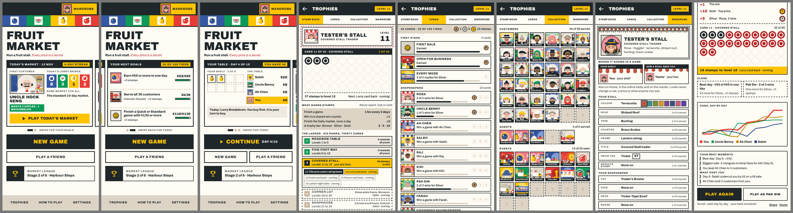

# REP-112 · Release 1.21.0: the stamp book, plainer labels, purchases hidden after buying, and the fixes from 1.20.0

| | |
|---|---|
| Game | Fruit Market 1.20.0 live (rules version 18); this build is 1.21.0, rules version 18 |
| Report date | 2026-11-12 (Asia/Kuala_Lumpur) |
| Type | Build and results report (PLAN-086, PLAN-089, PLAN-090; PLAN-087 for the print kit), and release preparation |
| Request | Owner, 2026-11-12: "the rest can be worked accordingly after it has been published" (DEC-105); "okay now go through all the required changes"; "fix so that rival's fruit doesnt show when placing fruit in the open stall/ crate ... it is hidden afterwards" (DEC-107) |
| Approval | The packages are approved and built. Publishing 1.21.0: awaiting the owner's word. |

## 1. What is in 1.21.0

| Part | What is built |
|---|---|
| Your ruling (DEC-107) | What a stall bought is drawn only while stalls are buying. From stocking on, a rival's box shows its cash and how many pieces are out, nothing else. RULES.md and How to play say the same. The rules version stays 18 |
| The stamp book (PLAN-086) | Stamps for days played, wins, the Daily market and trophy steps; a stall level from 1 to 30 on six ranks. Trophies as 48 cards with Bronze, Silver and Gold steps. A collection of customers served and events seen. New Results, Trophies, Wardrobe and Home screens |
| The labels (PLAN-089) | Every screen in the plain voice. Where a label is drawn on a board you approved, the board's words are kept ("Open my stall · 3 out", "Ring the bell · seal 2 prices") |
| Fixes from 1.20.0 (PLAN-090) | The row of steps follows the bell and the bid. The takings wait for the last coin. A greyed upgrade opens its card. Larger touch areas on the market. The night's boxes read as empty once a piece has left; the shelf follows the night. The standing order's card slides in. The table no longer moves down on the morning an order appears. One chart colour for each stall. Signing out clears the stamp counts |
| The print kit (PLAN-087) | Every deck, both trackers and an update pack on rules 18, in the repo under `print/`. Not part of the live game |
| The privacy page | Names the stamp book's counts and the looks other players see |

## 2. Checks on the release code (`050fb22`)

| Check | Result | Evidence |
|---|---|---|
| `npm run verify` | PASS | 76 files, 819 tests passed, 1 skipped |
| `npm run test:e2e` | PASS | Machine quiet: solo game to the results with no errors; performance budget OK (longest task 125 ms against 200), 0.44 slow frames in a hundred, 602 page elements of 800; online match with 86 pricing frames and 0 leaks, rematch, an abandoned match taken over by a computer; quick match; four people and two computers; reconnect 5 of 5. |
| The same seed gives the same game | PASS | 277 computer games, one checksum before and after all the text work (helper) |
| Old progress loads; trophies and looks kept | PASS | Test on the stored shapes of 1.19.1 |
| Purchases hidden after buying | PASS | Test: the stalls row and every rival's details are drawn the same whatever a rival bought, at stocking, pricing and after the bell. Seen by me in the first picture above |
| The table rows keep their places, order days included | PASS | Helper's measure over a whole day and the next morning at both sizes |
| Every changed screen seen by me at 390 by 844 with 4 stalls and 360 by 640 with 6 | PASS | The day's seven screens and the stamp book's eight, from the merged build |
| The full checks on the CI machines | NOT RUN | They run when the build is merged to `main` |
| A person has played this build | NOT RUN | |

One test-script repair: after the label rewrite the online test tapped a note that holds the words "play again"; it now taps the button.

## 3. Choices that are yours (built as stated; say if you want another)

1. **Home's first page.** Your board shows today's event, but no game has an event on day 1. It shows the first customer and the lorry's load.
2. **Old games.** Games finished before this version count as 3 stamps each. A player with 64 old games starts near level 12.
3. **The market's boxes are a little lower every day** (33 px, not 38, on a tall phone) so that the table does not move on the morning a standing order appears. The other way keeps the larger boxes and lets the table move 34 px on those mornings.
4. **The fifth and sixth stalls' colours** changed (ink and pink) so the results chart has six distinct lines.
5. **Fourteen title names** earned by feats (League Champion, Fruit Tycoon, Hard Sweep, Sole Supplier, Top Price, Best Day, Roll Call, All Eight, By Appointment, Town Favourite, Veteran, Fruit Baron, Thirty Markets, Month of Markets) and the reward names (frames, price tags, bells, coins).
6. **Card wording on two boards** (Evening, Design A) differs from the game's cards for Order Book, Juice Bar, Favoured Trade and Shade Cloth. The game keeps the text audit's wording, which the print kit shares.
7. **Wording to check:** "open house", "pasar malam", "kopitiam", "jamu", "kenduri", "company family day", "Kampung Lorry".
8. **RULES.md** still names lorries and cards in the old wording (for example "Kampung Truck"). Updating its words changes no rule; it waits for your word.

## 4. Known gaps

- The bottom bar still shows Skip and the selling hint while the bell rings.
- With first-game tips on, on a small phone: a six-row shelf's last row lies under the tip until it is closed; pricing scrolls 12 px.
- Only the market is closed to keyboard and screen reader under a sheet; the strip, the stalls row and the shelf are not.
- A lane box you can buy from is 93 by 37 px on a tall phone and 87 by 32 px on a small one.
- The first version of the stamp book has 48 cards and 109 steps (the study names 55 and 125); a collection page does not open the full card.
- Bell and coin sounds were not heard in a browser test (they run silent).
- Old styles for the first Trophies, Wardrobe and Home screens are still in the code, unused.
- Not played by a person. Not proof-printed.

## 5. What a player meets on updating

- Trophies and looks are kept; stamps and a stall level appear, worked out from what was already stored.
- No rule changes: the rules version stays 18, saved games continue, and old and new versions can play each other online.
- The privacy page is updated in the same release.
