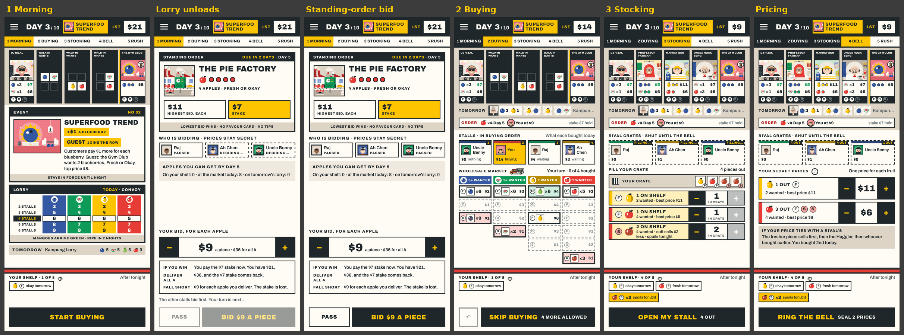
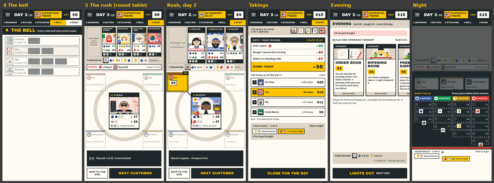
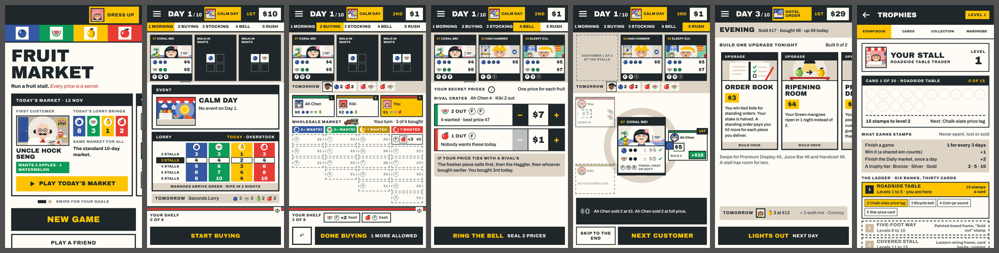

# REP-115 · Candidate 1.21.0 with the round-table rush: every step of a day

| | |
|---|---|
| Game | Fruit Market, candidate 1.21.0 (branch `ccr-d8bcd65d-gblqqb`), rules version 18 unchanged. Live is still 1.20.0 |
| Report date | 2026-11-13 02:42 (Asia/Kuala_Lumpur) |
| Type | Work completed, and what each step of a day looks like |
| Request | Owner, 2026-11-12: "go through each phases and share what screens (can be a recording) look like for each" |
| Approval | PLAN-091 and PLAN-092 approved and implemented. Publishing 1.21.0 is **not approved**; it needs the owner's word |

## 1. What 1.21.0 gained since REP-112

REP-112 described the candidate with the stamp book (PLAN-086), the boards' words (PLAN-089) and the fixes with DEC-107, purchases shown only while buying (PLAN-090). Since then:

- **The rush is a round table (PLAN-092, DEC-109).** Each customer comes from the row to the middle of the table. Every stall's open crate sits round it in a fixed seat for the whole rush, with its price tag for the fruit being bought. A crate over the customer's price is dimmed; a crate without that fruit is dashed and says so. The selling crate is marked, its pieces travel to the customer and the coins travel back. The result line, Skip to the end and Next customer stay. The list of offers under each customer card is gone.
- **The finishing pass (PLAN-091).** The bell rings once, with the player's chosen bell. The bottom bar is quiet during the bell, the rush and the night. First-game tips fit a small phone. The collection opens each card in full. Results say Rematch and Main menu; Home says Dress up. A rival's favour card is named only from what the game shows everyone, and a rival's won card stays face down. On a shared phone the results speak to the phone's owner. RULES.md and the printed kit use the cards' words, and at the table each stall pays itself (DEC-108). Unused code from the rebuild was removed. The store screenshots show the new screens.

No rule, number, save or online message changed.

## 2. What each step looks like

A recording of Days 1 to 3 of a four-stall game at the normal pace (2 min 34 s) was sent to the owner with these sheets. Tall phone (390 by 844).

## 3. Checks on the merged code (`0185fb6`)

| Check | Result |
|---|---|
| `npm run verify` (lint, types, 838 tests, build) | PASS (1 skipped, as before) |
| `npm run test:e2e`: solo game, performance budget, online match, quick match, four players, reconnect | PASS: longest frame 151 ms against 200; 44 pricing frames, 0 secret prices leaked; rematch and takeover; reconnect 5 of 5 |
| Nothing in the rush changes before its customer (frame by frame, 37 runs) | PASS: 0 problems |
| A rival's won favour card stays face down; pass-and-play leaks | PASS: 0 leaks |
| Four customers play through untouched | PASS: 10.9 s |
| Seen by me at 390 by 844 and 360 by 640, with 2, 4 and 6 stalls, beside the Rush-D board | PASS |
| Proof print of the kit | NOT RUN (owner) |
| CI on GitHub for 1.21.0 | NOT RUN: runs when the branch is merged to `main` |
| Played by people | NOT RUN for 1.21.0 |

## 4. Known gaps

- The morning scrolls 63 px on a small phone with six stalls; the event chip in the top bar is cut at 360 px.
- About 700 unused old style rules remain; small tap targets and low-contrast labels from the QA sweep.
- The performance budget can fail when the build machine is busy (206 to 344 ms seen while helpers ran); it passes when quiet and on CI.

## 5. What the owner decides

1. Publish 1.21.0 (with the round table). On his word: merge to `main`, CI, *Deploy LIVE game*, smoke test, release marked published.
2. Standing orders (REP-113, REP-114): (a) keep the numbers and show the sums on the bid sheet (recommended); (b) take his proposal, $2 higher top bid and $2 lower stake (rules 19); (c) test a direct mango fix.
3. Still open from REP-112 section 3, "Main menu" and "Dress up" against "Home" and "Wardrobe", and tracker 1 or 2 after a proof print.
