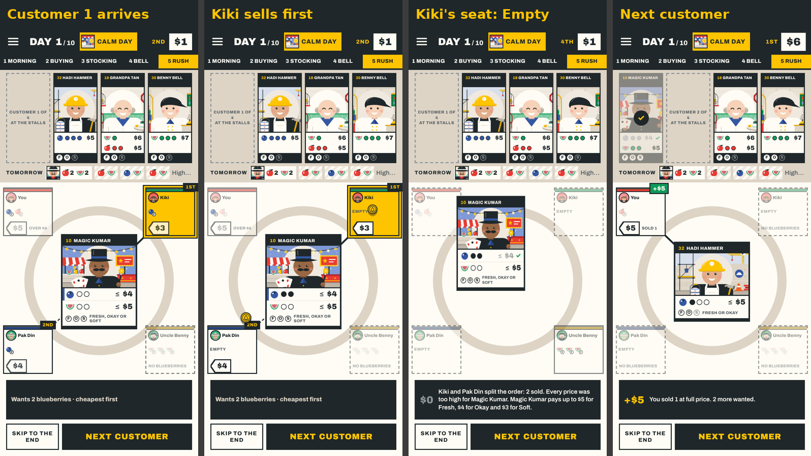
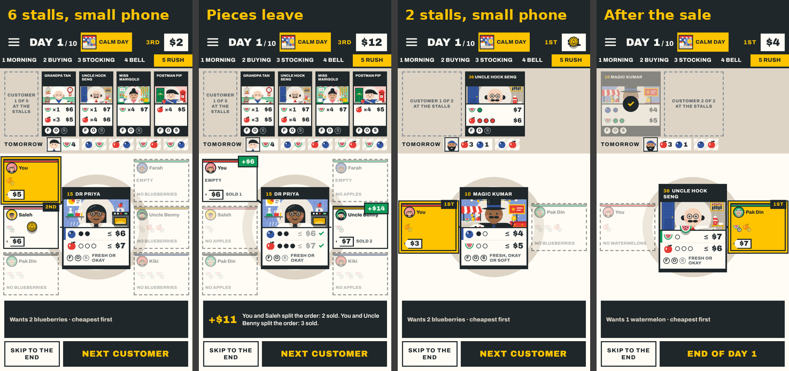
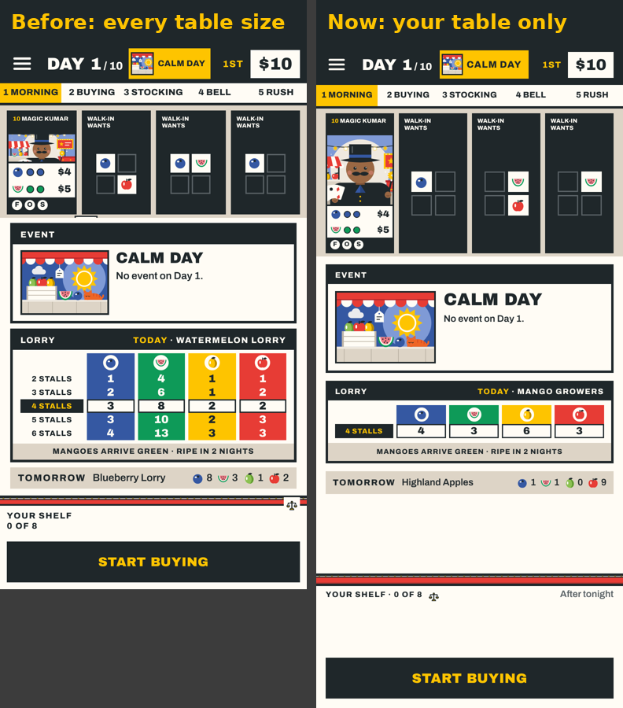

# REP-116 · The rush's seats hold their fruit; the lorry card shows your table only

| | |
|---|---|
| Game | Fruit Market, candidate 1.21.0 (branch `ccr-d8bcd65d-gblqqb`), rules version 18 unchanged. Live is still 1.20.0 |
| Report date | 2026-11-13 08:27 (Asia/Kuala_Lumpur) |
| Type | Work completed |
| Request | Owner, 2026-11-13: "for the rush phase, make it so that fruits for sale is on the player & rival's respective round table, fruit should disappear from a player's round table after a customer took it" and "when the cards are drawn during buying phase, just keep the relevant lorry unload info, dont show the full supply profile for other stall counts" |
| Approval | DEC-110, approved by the owner's own words; built as PLAN-093 into candidate 1.21.0. Publishing is **not approved** |

## 1. What changed

**The rush.** Every seat round the table now shows all the fruit that stall has out for sale, piece by piece with its freshness letter (F, O, S), from the first customer to the last. When a customer takes a piece it travels from the seat to the customer and is gone from the seat; a seat that has sold everything says "Empty". While a fruit is being bought the seat's other fruit is greyed, and its price tag for that fruit shows beside what became of the offer. The money a stall earns now sits in the corner where its "1st" or "2nd" was, so it no longer covers "Sold 1". The price tag's outline now follows its pointed end (it used to leave a stray mark). The seats are a little taller to fit two rows of five pieces.

**The morning's lorry card.** It shows one row: what the lorry unloads at your table ("4 stalls" with its four numbers), or the "Today" row when an event changed the load. The rows for other table sizes are gone. The printed card keeps every size, because a table of any size uses it. The morning is shorter as a result.

No rule, number, save or online message changed.

## 2. Pictures

## 3. Checks

| Check | Result |
|---|---|
| `npm run verify` (lint, types, 839 tests, build) | PASS (1 skipped, as before) |
| New tests: each customer finds every crate as the one before left it, the first finds the bell's crate; a piece leaves the seat as it lifts off and not before; the other fruit is greyed; the lorry card has one row | PASS |
| Seen by me at 390 by 844 and 360 by 640 with 2, 4 and 6 stalls | PASS |
| `npm run test:e2e` | see PLAN-093 T2 |
| The owner has seen it | NOT RUN until he replies |

## 4. Known gaps

- A seat shows at most ten pieces; more than ten shows "+n" in the last place (a stall rarely puts out more than eight).
- On a 6-stall small phone the money badge can cover the end of a long name ("Uncle Benny") for the moment it shows.
