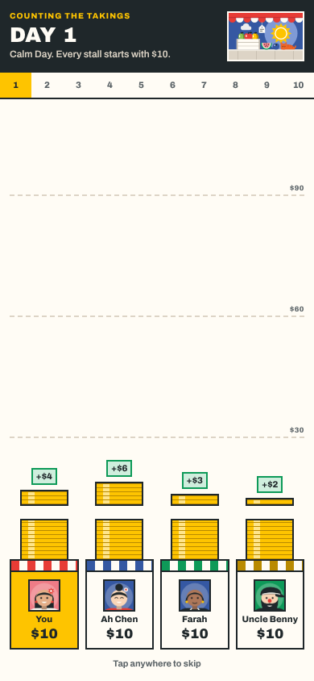
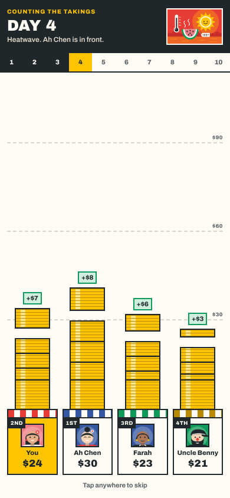
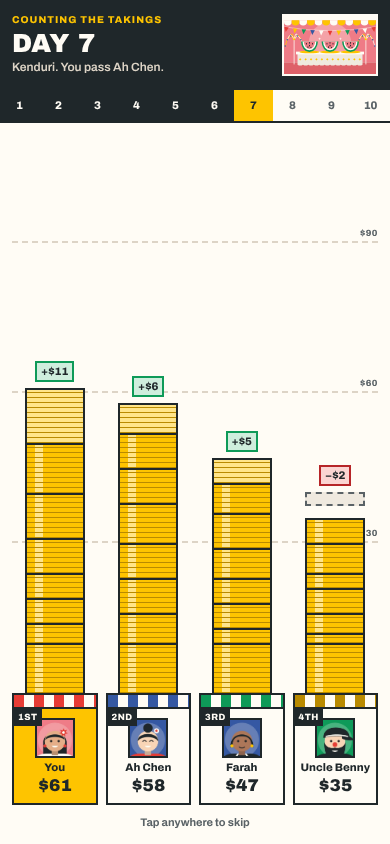
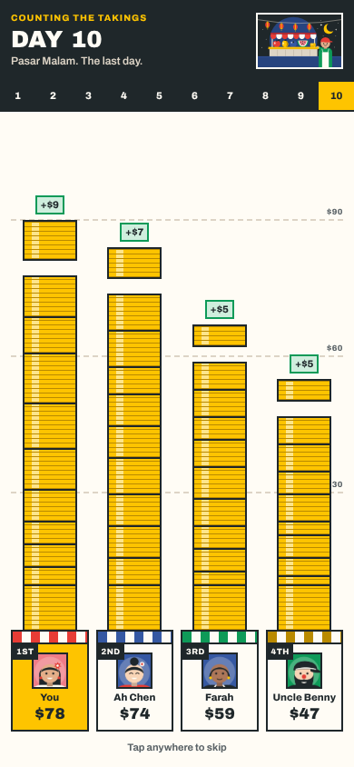
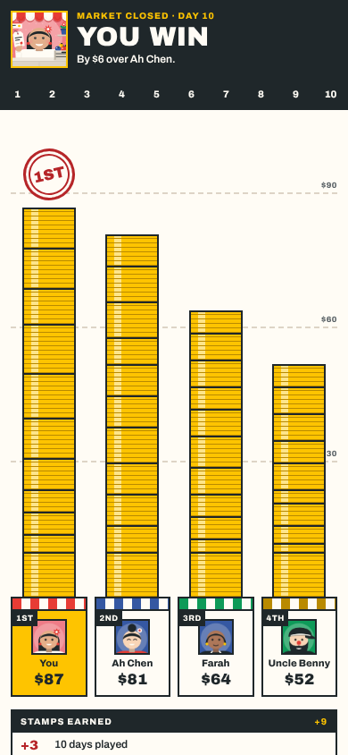
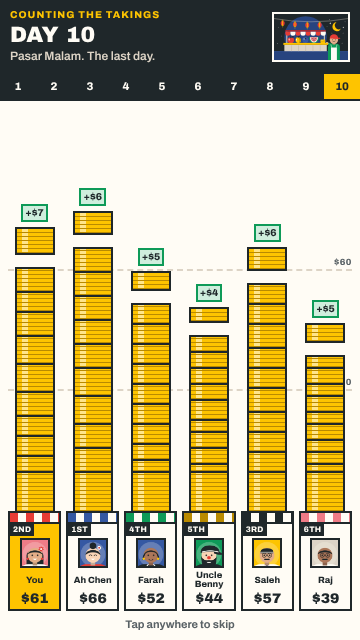

# REP-121 · The scene after the last day: three storyboards, the owner's pick, and the plan to build it

| | |
|---|---|
| Game | Fruit Market 1.23.0 live, rules version 19. The preview also holds PLAN-104 and PLAN-105 |
| Report date | 2026-11-16 06:45 (Asia/Kuala_Lumpur) |
| Type | Design mock-ups, and a plan for approval |
| Request | Owner, 2026-11-16: "design an animation scene which happens after a game ends, to show the results between player, suggest me 3 suitable animation, the animation needs to be in line with the current art style direction and in line with the overall fruit market narrative, think also the UI/UX flow, just screenshots/moodboard (if that's a term) before building anything"; then "design A but with the coins falling per the 10 days"; then "yes" |
| Approval | The design: DEC-119, approved in the owner's words. Building it: PLAN-107, **awaiting approval**. Nothing is built |

Design page: https://claude.ai/artifact/LU9e6gkRRRgrxHFwpF3yPP (first page: the chosen design; second page: the first three options).

## 1. What was asked and what was chosen

Three storyboards were drawn in the Market Ticket look, each with the game's own pictures:

| Option | Idea | Outcome |
|---|---|---|
| A · Counting the takings | A coin stack for each stall, all rising together; a stack stops at that stall's cash | **Chosen, with a change** |
| B · Closing time | Night falls; shutters come down last place first; the last lamp on wins | Not chosen |
| C · The ten days | The game again day by day as cash bars under each day's event card | Not chosen; its day-by-day idea went into A |

The owner's change to A: the coins fall for each of the game's days. His "yes" answered three questions asked together (is this the design to build, may the last takings sheet show only your own day, is about 5.5 seconds skipped by a tap right) and is taken as yes to all three.

## 2. The chosen design

The boards are kept as `Count-1` to `Count-6` in `docs/studio/review-18/mockups` (sources in `boards`, pictures in `png`).

| Board | Moment | What it shows |
|---|---|---|
| Count-1 | Day 1 | Every stall starts with its \$10. The first day's coins are in the air, each with a tag (+\$4, +\$6) |
| Count-2 | Day 4 | Three days are stacked, a line between each. Day 4's coins fall. Each plate shows its place and cash |
| Count-3 | Day 7 has landed | The new band is lighter. You pass Ah Chen and the places change. Uncle Benny ended the day down: coins leave the top, with a red tag (−$2) |
| Count-4 | Day 10 | The last day's coins fall |
| Count-5 | The result | The red 1ST stamp on the winner; the headline becomes "You win · By $6 over Ah Chen"; the stamps earned rise from below |
| Count-6 | Six stalls, 360 by 640 | The same on the smallest phone with the fullest table: narrower stacks, names on two lines |

 

 

 

## 3. Where it sits in the game

| Step | Today | With PLAN-107 |
|---|---|---|
| Last rush | Day 10's customers are served | Unchanged |
| Day 10 takings | Your day, then every stall's final cash, so the winner is known here | Your own day only |
| The count | (none) | About 5.5 seconds, plays by itself |
| Results | The whole page appears in one frame | The same page; the winner and places are already there |
| Stamps earned, Rematch or Home | As built in PLAN-086 | Unchanged |

## 4. How the count behaves

- **By itself.** It never waits for a tap, so an online room and the browser tests are not held up.
- **A tap skips.** A tap anywhere jumps to the final picture.
- **Same length for any game.** About 4.5 seconds for the days, whether there are 8, 10 or 14, then about a second to read. Fast rivals makes it quicker, as it does every other beat.
- **Reduced motion.** The final picture at once; the pause to read it stays.
- **Online.** Each phone plays it by itself. Rematch works as today once it ends.
- **A shared phone.** The headline names the winner; there is no "You" (as today's results).
- **Level stalls.** Every stall that shares the win is stamped 1ST in the same beat.
- **Once.** Not again after a reconnect or when a finished game is opened again.

## 5. What PLAN-107 builds, and what it leaves alone

Built: the count at the top of the Results page; the last day's takings without the stalls list; the win or lose sound moved to the stamp; tests and pictures.

Left alone: rules, balance and scoring (rules version stays 19); saves; the room server; the leaderboard; the anonymous counters; the rest of the Results page; the print kit. No new pictures, sounds or dependencies. Publishing the live game needs its own approval.

## 6. Notes for the build

| Part | Where | Note |
|---|---|---|
| The numbers | `src/engine/game.ts` (`finishReveal`) | Each day's record holds every stall's closing cash and the day's event card. The Results page's cash chart already draws from it |
| The last day | `src/engine/game.ts` (after the day's record) | The jam maker's money is added after the last record, so the last drop must end on the final cash |
| The start | `START_CASH`, the Nest Egg perk | The first band is the starting cash, not always $10 |
| An evening purchase | The day's record is written before the evening | An upgrade bought in the evening comes out of the next day's band |
| The page | `src/ui/game/panels/Results.tsx` | The stamps earned start today when the page opens; they must wait for the count |
| The takings | `src/ui/game/panels/SalesSummary.tsx` (`stallRows`, "The stalls after Day N") | Left out on the final day only; `tests/takings.test.ts` and `tests/closing-day.test.ts` cover this sheet |
| The sound | `src/ui/game/useGameController.ts` | The win or lose sound plays when the game ends; it moves to the stamp |
| The browser tests | `scripts/smoke.cjs`, `e2e-online.cjs`, `perf-budget.cjs`, `qa-sweep.cjs` | They look for the `results` page and the words "See results" and "Rematch". Both stay |
| Lengths and speed | `src/ui/motion.ts`, `src/ui/anim.ts` | The count's lengths are named there with the others, so Fast rivals, the tap and reduced motion apply |

## 7. Risks and costs

| Risk | How it is contained |
|---|---|
| The count delays Rematch by a few seconds in the online browser tests | It ends by itself; the tests are run before anything is merged (T2) |
| Six stalls on a small phone, long names | Drawn as Count-6; pictures with 2, 4 and 6 stalls are a check (T3) |
| A game with no day records (an old save) | Shows the final picture without the days (T1) |
| Day by day, every stack finishes together, so the first design's "short stacks stop first" moment is gone | The lead changes on the plates carry the tension; the owner's playtest decides (T5) |
| The count becomes a chore after many games | A tap skips it; review trigger in DEC-119 |

Cost: RM0. No paid service.

## 8. Checks

| Check | Result |
|---|---|
| 21 boards drawn on the design page and looked at (the three options, the chosen design, the flow and the parts) | PASS |
| The six chosen boards drawn again from the repo with `render.py` | PASS |
| Six stalls at 360 by 640 as a drawing (Count-6) | PASS |
| Tables of 2, 3 and 5 stalls; games of 8 and 14 days | NOT RUN (drawings only for 4 and 6 stalls, 10 days) |
| The count's length | NOT RUN (about 5.5 seconds is worked out, not measured) |
| `npm run records:check` | PASS |
| `npm run verify`, `npm run test:e2e` | NOT APPLICABLE (no game code changed) |

## 9. What the owner is asked

Approve PLAN-107 to build the count as drawn, or say what to change first.
