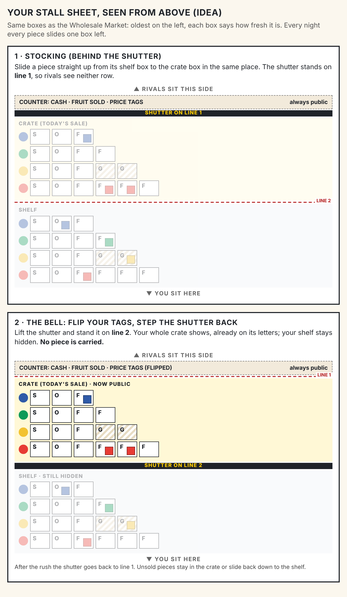

# REP-126 · New table set, revised: the app's market boxes everywhere, and a crate shown by stepping the shutter back

| | |
|---|---|
| Game | Fruit Market, tabletop version, rules version 20 |
| Report date | 2026-11-16 20:51 (Asia/Kuala_Lumpur) |
| Type | Proposal (revises REP-125) |
| Request | Owner, 2026-11-16, answering REP-125: "im okay to use a tracker similar to the wholesale market one in app currently (which should be the physical wholesale market as well) and to use it for the personal tracker, but the personal one is just too troublesome when players are fllipping during auction" |
| Approval | Awaiting the owner (DEC-121, PLAN-111 as revised here) |
| Build | Nothing built yet |

## 1. The owner's choice

- **Freshness:** the boxes the app's Wholesale Market shows. Each fruit has a lane of boxes, oldest on the left, each marked with its freshness (G, F, O, S). Every night every piece slides one box left. This is used on the market board and on each stall sheet.
- **The ruler (REP-125's recommendation) is dropped.** So are the card stacks and the dice.
- **The problem to solve:** at the bell (the reveal of secret prices), today's tabletop rule makes each stall carry its crate pieces, one by one, from behind its shutter onto its counter, each into the same box. That is the "too troublesome" part.

I read "flipping during auction" as the bell, when price tags flip and crates open. If the owner meant something else, the next step changes.

## 2. The fix: step the shutter back, carry nothing

**The stall sheet layout,** from the rivals' side to the player:
- the counter (cash track, Fruit sold row, price tags), always public;
- shutter **line 1**;
- the **crate band** (four fruit lanes);
- shutter **line 2**;
- the **shelf band** (the same four lanes).

Each crate box sits straight in front of the shelf box with the same letter and place.

**How it plays:**
1. **Stocking:** behind the shutter on line 1, slide each piece you want to sell straight up from its shelf box into the crate box in front of it. This is the same move as today, inside one sheet.
2. **The bell:** flip the price tags, then lift the shutter and stand it on line 2. The whole crate is now in view, every piece already on its letter. The shelf stays hidden. One move per stall, and no piece is carried.
3. **After the rush:** the shutter goes back to line 1. Unsold pieces stay in the crate or slide back down.
4. **Night:** every piece in both bands slides one box left, as on the market board.

**Why this rather than a loose crate tray** (tracker test 2):
- There is no extra part to cut.
- The crate cannot drift out of line with the shelf.
- The shutter is the only thing that moves.

The tracker test 1 sheet already used the two shutter lines. This keeps that and puts the app's boxes in place of the ruler.

## 3. The table set, revised

| Part | How many | Change from REP-125 |
|---|---|---|
| Market board: the Wholesale Market | 1 A3 panel | **The app's market look:** four fruit lanes, each box with its letter and its cost. No columns, no ruler |
| Market board: the street, and the customer rows | 2 A3 panels | Unchanged |
| Stall sheets | 6 | **Two bands (crate in front, shelf behind) and two shutter lines.** About A4 landscape. The counter strip can sit on the same sheet or stay a separate card; the size settles it in step 1 |
| Shutters | 6 | Unchanged (half an A3 sheet, folded to stand). They must stand firmly and lift with one hand |
| Rulers | — | **Dropped** |
| Price tags, token sheet, wooden cubes, pens | as before | Unchanged |

**Retired:** both tracker test packs (`print/tracker-test`) and the update pack (`print/update-20`).

No game rule changes and the app is unchanged. Only the table procedure at the bell changes, which the guidebook, the player aid and RULES.md's print-and-play part describe.

## 4. The plan (PLAN-111, revised)

1. Draw the stall sheet (two bands, two lines) and the market panel in the app's box style, from the game data.
2. Draw the street panel, the customer-row panel, the shutters, the counters, the price tags and the token sheet.
3. Update the guidebook, the player aid and RULES.md.
4. Tests from the data:
   - every part counted;
   - card spaces fit 63 × 88 mm;
   - boxes fit a 10 mm cube;
   - each lane has its fruit's boxes;
   - each crate box lines up with its shelf box;
   - the day track runs to 14.
5. Every page seen as a picture.
6. The print-shop package rebuilt, with the print order and the shopping list.
7. **The owner's small test:** one stall sheet, one shutter and the market panel, a few days with coins or beads. Then the full print.

## 5. Risks and costs

- **My work:** RM0. Printing, cubes and pens are the owner's spending.
- **Mistakes behind the shutter:** sliding fruit at night still happens there, so a missed slide cannot be seen. Everyone slides at the same moment, after "lights out", to keep it a habit.

## 6. Questions for the owner

1. **Approve PLAN-111** as revised here?
2. **Fruit pieces:** wooden cubes, 10 mm, in four colours (my pick), or printed fruit tiles from the shop?
3. **Board:** laminated A3 panels (my pick), or mounted on foam board?
