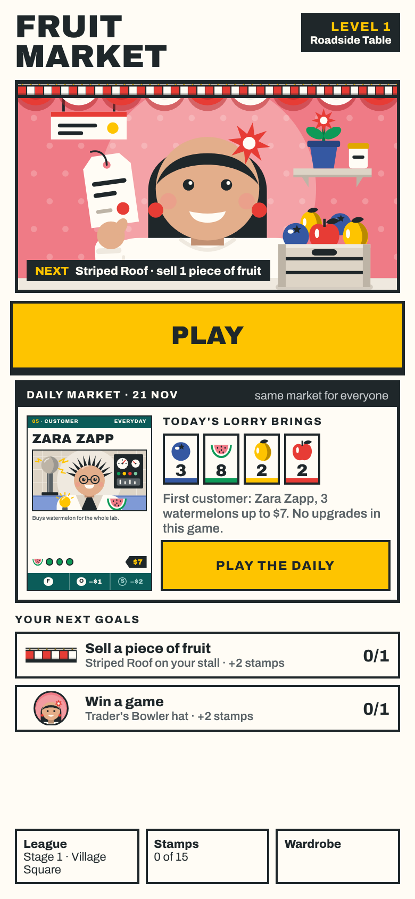
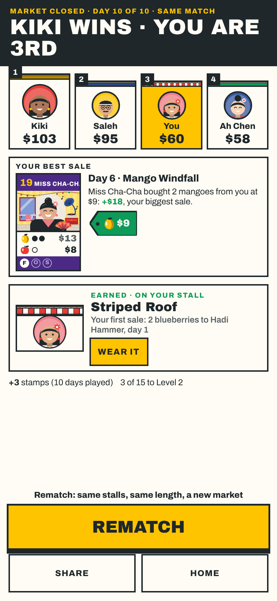

# REP-129 · Redesign mock-ups, and the revised player journey

| | |
|---|---|
| Game | Fruit Market 1.25.0 live (rules version 20); 1.26.0 (PLAN-112) built, not yet on the preview |
| Report date | 2026-11-21 16:55 (Asia/Kuala_Lumpur) |
| Type | Design review and approval |
| Request | Owner, 2026-11-21: a design audit and three rounds of mock-up briefs (real art, one four-player day, the full journey); then "implement page 6 from the mockup into the live game, approve", clarified: "page 6, meaning the whole ui/ux journey across the rest of the journey you shared" |
| Approval | The revised journey, the nine screens of the v3 journey board (DEC-123, PLAN-113), approved 2026-11-21. The gameplay screens (Buying to Day Close) wait for the owner's answer |

## 1. The mock-ups

- Design canvas: https://claude.ai/artifact/Rj7pKapLWqZL1z196mRMST (page "v3 · four-player day").
- Built from the game's own art components and one real four-player match (seed 12345; you as Rosa against Ah Chen, Kiki and Saleh), captured from a local copy of the build.
- Pages: v1 first draft (superseded), v2 one sale with real art, v3 the four-player day and the full journey (Home, Play, Quick match wait, private room, first sale, Results, League, Stamp Book, Wardrobe).
- Kept out because they would change rules or modes: a shorter Quick match, a shorter Daily market.

## 2. Approved: the revised journey (nine screens)

 

| # | Screen | What changes for the player |
|---|---|---|
| 1 | Home | Your illustrated stall and shopkeeper, one Play, the Daily market with its real first customer card and the lorry's fruit, the next unlock shown on your stall, two goals |
| 2 | Play menu | One screen: Quick match, Private room, Join with a code, Computer, One phone, each with its real player count and length |
| 3 | Quick match wait | Your shopkeeper card against an empty stall, a timer, a practice price on a real customer card, a computer game one tap away |
| 4 | Private room | Code and Share link on top; each seat a stall with awning, face and Ready; an empty seat offers a computer |
| 5 | First sale | New guided entry: the day-1 table, one decision (your price), all four stalls, Ring the bell |
| 6 | Results and Rematch | Rank tiles with each stall's awning, portrait and cash; your best sale on the customer's card; an earned reward on your stall; stamps; a large Rematch |
| 7 | Market League | The current stage first with its rival's portrait, then the six stages with real rivals, levels and lengths |
| 8 | Stamp Book | Your stall, the stamp card, the next reward drawn as it will look |
| 9 | Wardrobe | Your stall as rivals see it, the item equipped; each item drawn, with how to earn the locked ones |

- Current rules only: nothing about scoring, rewards, match length or modes changes. Today's features stay (stamps animation, cash chart, Daily board, online rematch, public rooms from PLAN-112).
- The practice price while waiting and the first-sale entry use the same rules as a real day.

## 3. Checks

| Check | How |
|---|---|
| T1 | `npm run verify` |
| T2 | `npm run test:e2e` (solo game, quick match, private rooms, public rooms, rematch; 0 leaks) |
| T3 | Screens at 390, 360 and 320 for all nine: Results as a win, a loss, a shared win, with and without an unlock, 2 and 6 stalls, Daily and online; Home before and after a first game; a full and an empty private room |
| T4 | The owner on the preview |

## 4. Open

- The stamps line: the mock-up's "+3" follows the rule of 1 stamp per 3 days; the capture showed "+0" mid-count. Checked in T3.
- Publishing to the live game still needs the owner's word for that build.
